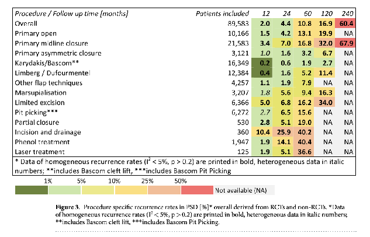
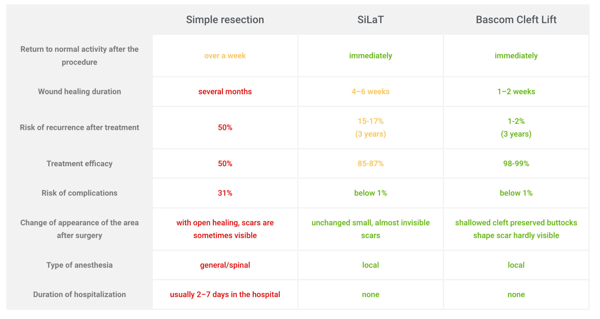

1. # Table of contents {#table-of-contents}

[1\. Table of contents](#table-of-contents)

[2\. Introduction](#introduction)

[What is a pilonidal cyst](#what-is-a-pilonidal-cyst)

[Why this guide](#why-this-guide)

[My pilonidal cyst story](#my-pilonidal-cyst-story)

[3\. Immediate help](#immediate-help)

[If you are in a lot of pain right now](#if-you-are-in-a-lot-of-pain-right-now)

[Manageable Pain: The Role of Antibiotics](#manageable-pain:-the-role-of-antibiotics)

[Extreme Pain: When Lancing Becomes Necessary](#extreme-pain:-when-lancing-becomes-necessary)

[Post-Procedure Care and Healing](#post-procedure-care-and-healing)

[Looking Ahead: Long-Term Considerations](#looking-ahead:-long-term-considerations)

[A Word of Advice](#a-word-of-advice)

[4\. Pilonidal Cyst Terminology](#pilonidal-cyst-terminology)

[Resources:](#resources:)

[5\. Symptoms and Diagnosis](#symptoms-and-diagnosis)

[Common Symptoms](#common-symptoms)

[Identifying a Pilonidal Cyst](#identifying-a-pilonidal-cyst)

[When to See a Doctor](#when-to-see-a-doctor)

[Diagnosis Challenges](#diagnosis-challenges)

[Community Support](#community-support)

[6\. Causes and Risk Factors of Pilonidal Cysts](#causes-and-risk-factors-of-pilonidal-cysts)

[Primary Causes](#primary-causes)

[Risk Factors](#risk-factors)

[Common Misconceptions](#common-misconceptions)

[7\. Non Surgical Care](#non-surgical-care)

[Initial Flare-up and Natural Remedies for Pilonidal Cysts](#initial-flare-up-and-natural-remedies-for-pilonidal-cysts)

[Home Remedies and Natural Treatments](#home-remedies-and-natural-treatments)

[Warm Compression Techniques](#warm-compression-techniques)

[Sitz Baths](#sitz-baths)

[Hygiene Practices](#hygiene-practices)

[The "Reddit Protocol"](#the-"reddit-protocol")

[Important Considerations](#important-considerations)

[Managing an Inflamed and Draining Pilonidal Cyst](#managing-an-inflamed-and-draining-pilonidal-cyst)

[The Role of Antibiotics in Pilonidal Cyst Treatment](#the-role-of-antibiotics-in-pilonidal-cyst-treatment)

[Why Antibiotics Are Used](#why-antibiotics-are-used)

[Types of Antibiotic Treatment](#types-of-antibiotic-treatment)

[Effectiveness and Considerations](#effectiveness-and-considerations)

[When to Consider Surgery](#when-to-consider-surgery)

[8\. Surgical options](#surgical-options)

[What types of surgeries are there?](#what-types-of-surgeries-are-there?)

[Lancing](#lancing)

[Drainage](#drainage)

[Marsupialization](#marsupialization)

[Laser](#laser)

[EPiST](#epist)

[SiLaT](#silat)

[Pit Picking (also known as Bascom I)](#pit-picking-\(also-known-as-bascom-i\))

[VAAPS](#vaaps)

[Cleft Lift](#cleft-lift)

[When is cleft lift recommended?](#when-is-cleft-lift-recommended?)

[Limberg flap reconstruction](#limberg-flap-reconstruction)

[Karydakis Flap procedure](#karydakis-flap-procedure)

[Who are the most specialized surgeons?](#who-are-the-most-specialized-surgeons?)

[US](#us)

[Dr T Bascom \- Cleft Lift \- OR (Now Retired)](#dr-t-bascom---cleft-lift---or-\(now-retired\))

[Dr Sternberg in CA](#dr-sternberg-in-ca)

[Dr Immerman in WI](#dr-immerman-in-wi)

[Dr Shrager and Dr Miller in NJ-Cleft lift/minimally invasive procedure](https://ptcnj.com/about/meet-our-medical-directors/)

[Dr Wadie \- Cleft Lift \- US, NC](#dr-wadie---cleft-lift---us,-nc)

[Dr Clifford \- Cleft Lift \- US, Richmond VA](https://virginiacarepartners.com/physicians/profile/Clifford-L-Deal-MD)

[Europe](#europe)

[Dr. Zapotoczny \- Cleft lift \- Poland](#dr.-zapotoczny---cleft-lift---poland)

[Germany:](#germany:)

[Dr. Luigi Basso](#dr.-luigi-basso)

[UK](#uk)

[Emin Carapeti \- Cleft Lift](#emin-carapeti---cleft-lift)

[Miss Asha Senapati \- Cleft Lift](#miss-asha-senapati---cleft-lift)

[What type of anesthesia is used?](#what-type-of-anesthesia-is-used?)

[Costs](#costs)

[US costs](#us-costs)

[After surgery care tips](#after-surgery-care-tips)

[Cleft Lift](#cleft-lift-1)

[Wound care](#wound-care)

[What activities are okay?](#what-activities-are-okay?)

[Sports:](#sports:)

[Swimming:](#swimming:)

[Bike Riding:](#bike-riding:)

[Horseback Riding:](#horseback-riding:)

[Intimacy/Sex:](#intimacy/sex:)

[Nutrition](#nutrition)

[Recovery times](#recovery-times)

[Surgery recurrence rates](#surgery-recurrence-rates)

[9\. When Surgery goes wrong](#when-surgery-goes-wrong)

[Some stories](#some-stories)

[Treatment options](#treatment-options)

[The psychological effects](#the-psychological-effects)

[The aesthetics](#the-aesthetics)

[Stories](#stories)

[10\. Prevention Strategies](#prevention-strategies)

[Maintaining good personal hygiene](#maintaining-good-personal-hygiene)

[Sitting](#sitting)

[Comfy clothes](#comfy-clothes)

[11\. Coping with the Condition](#coping-with-the-condition)

[Emotional support for sufferers and caregivers](#emotional-support-for-sufferers-and-caregivers)

[Women-specific tips](#women-specific-tips)

[12\. FAQ: Frequently Asked Questions](#faq:-frequently-asked-questions)

[Do I NEED to get surgery?](#do-i-need-to-get-surgery?)

[Should I open the cyst by myself?](#should-i-open-the-cyst-by-myself?)

[It really hurts, what do I do?](#it-really-hurts,-what-do-i-do?)

[Does it ever disappear by itself?](#does-it-ever-disappear-by-itself?)

[How much does laser hair removal help?](#how-much-does-laser-hair-removal-help?)

[When do I see a doctor?](#when-do-i-see-a-doctor?)

[Can I have surgery if the cyst is currently infected?](#can-i-have-surgery-if-the-cyst-is-currently-infected?)

[What does taking antibiotics do?](#what-does-taking-antibiotics-do?)

[How do I keep future flare ups as low as possible?](#how-do-i-keep-future-flare-ups-as-low-as-possible?)

[Should I wait to see if it comes back or address it immediately?](#should-i-wait-to-see-if-it-comes-back-or-address-it-immediately?)

[How do I find a surgeon? How do I know they are skilled?](#how-do-i-find-a-surgeon?-how-do-i-know-they-are-skilled?)

[Is it a Pilonidal cyst or an anal fistula? What else could it be?](#is-it-a-pilonidal-cyst-or-an-anal-fistula?-what-else-could-it-be?)

[How many people suffer from this condition?](#how-many-people-suffer-from-this-condition?)

[13\. Warnings](#warnings)

[Sinus tracts have some risk of developing cancer if untreated for decades](#sinus-tracts-have-some-risk-of-developing-cancer-if-untreated-for-decades)

[Non specialists cutting the midline can make a mess, see a specialist asap](#non-specialists-cutting-the-midline-can-make-a-mess,-see-a-specialist-asap)

[Addressing it early is the best bet](#addressing-it-early-is-the-best-bet)

[14\. Online Support](#online-support)

[15\. Controversies](#controversies)

[16\. Some wilder theories](#some-wilder-theories)

[Pilonidal Sinus And Prolonged Sexual Stimulation: The Poisonous Hormones](#pilonidal-sinus-and-prolonged-sexual-stimulation:-the-poisonous-hormones)

[German New Medicine](#german-new-medicine)

[Infrared Light treatment](#infrared-light-treatment)

[17\. Conclusion](#conclusion)

[Appendix](#appendix)

[Images](#images)

[Reading list/Resources](#reading-list/resources)

[Surgery for pilonidal cyst: MedlinePlus Medical Encyclopedia](#surgery-for-pilonidal-cyst:-medlineplus-medical-encyclopedia)

[Papers](#papers)

[Other resources](#other-resources)

[Pilonidal Library \- Pilonidal Support Alliance](#pilonidal-library---pilonidal-support-alliance)

# 

# 

2. # Introduction {#introduction}

   ## 

## What is a pilonidal cyst {#what-is-a-pilonidal-cyst}

A pilonidal cyst, more accurately termed a pilonidal abscess, is a painful condition that typically develops in the natal cleft, commonly known as the buttock crease. Despite its name meaning "nest of hairs," this condition isn't always associated with hair presence. Pilonidal disease involves an abscess beneath the skin, often originating from an expanded or exploded follicle called a "pit" in the midline of the buttock cleft. These abscesses are prone to severe infections and can form additional sinuses, which are passages linking the abscess to the skin surface. Primarily affecting individuals between 16 and 26 years old, pilonidal disease rarely resolves on its own and often requires medical intervention. Understanding this condition is crucial for proper diagnosis and treatment, as pilonidal abscesses can significantly impact a person's quality of life due to their painful and recurring nature.

[Pilonidal Disease Fact Sheet](https://www.pilonidal.org/what-is-pilonidal-disease/pilonidal-disease-fact-sheet/)

## Why this guide {#why-this-guide}

After spending hundreds of hours on the internet learning about this condition, it's painfully obvious that most of the useful knowledge comes from people who have suffered through hell due to their doctors' ignorance. There seem to be a handful of experts sharing their opinions on best practices, and a hoard of outdated knowledge being taught to doctors. This routinely leads people through several failed operations, wounds that don't heal for months on end, more expensive procedures, and the painful realization that it was all avoidable by learning more about the condition first. But of course, we all learn to trust doctors until something goes wrong.

As I'm going through my own journey of being recommended several different courses of action by various doctors over the years, I've committed to learning all I can about it before deciding which surgery to pursue. I'm also feeling grateful for having the time, space, and digital literacy required to research this information on the internet, forums, and subreddits. I know not everyone has this luxury, and this awareness is inspiring me to write this guide so that people who don't necessarily have access to these privileges can still learn from my search.

So, what you'll find in this guide is:

* An organized collection of various internet resources about pilonidal cysts, including links to social posts and people's direct experiences  
* A summary of the most commonly used terms in the field, including all the different types of surgeries  
* Answers to many questions that I and others have when learning they are affected by this condition  
* Answers to questions most official sources don't directly address, such as: women-specific tips, whether it's okay to swim, and if it's safe to have sex

What you won't find in this guide:

* **This isn't medical advice; I'm not a doctor.** I'm just a fellow sufferer overwhelmed by the amount of information and wanting to make it more digestible  
* This isn't cutting-edge research, and I have found no definitive answers to questions like: which surgery is best, or can it be cured forever? I did find several research studies and included their results, plus numerous case studies collected from forums.

## My pilonidal cyst story {#my-pilonidal-cyst-story}

I had my first encounter with the world of pilonidal cysts in 2018\. Living as an international student in the Netherlands, I visited the doctor's office with an incredibly painful lump on my tailbone. She attempted to open it without any anesthetic, but I couldn't bear the pain. She then advised me to take Advil, apply hot compresses, and clean the area when it opens, while watching for fever and signs of infection. She also suggested waiting to see if it recurs before considering an operation. I didn't question her advice; the abscess resolved itself over a few days, and for more than a year, I was okay.

Then the anxiety started. I experienced varying levels of pain in the area, constantly stressing about it and worrying it was about to get infected again. Since then, it has recurred four times. I've been traveling over these years, intending to address the situation at some point but repeatedly postponing it. I got on the waiting list for surgery in Canada at one point, but the hospital didn't call back for over two years.

As of now, it's much less painful, but it does drain more often. I've decided to have the operation done privately in Europe, where I currently live. I'm grateful I chose to read extensively about it before committing to the first surgeon I found nearby.

3. # Immediate help {#immediate-help}

## If you are in a lot of pain right now {#if-you-are-in-a-lot-of-pain-right-now}

Dealing with a pilonidal cyst can be an extremely painful and distressing experience. Whether you're facing this condition for the first time or experiencing a recurrence, it's crucial to understand your options for managing pain and seeking appropriate treatment. This guide will walk you through the steps you can take based on your pain level and the severity of your condition.

## Manageable Pain: The Role of Antibiotics {#manageable-pain:-the-role-of-antibiotics}

If you're experiencing mild to moderate pain, your doctor might prescribe antibiotics as a first line of defense. It's important to understand that while antibiotics can provide temporary relief by knocking back the infection, they are not a cure for pilonidal disease. They serve as a stopgap measure, buying you some time and comfort while you consider more definitive treatment options.

Common antibiotics prescribed for pilonidal cysts include Keflex, Augmentin, and Cephalexin. Your doctor will choose the most appropriate one based on various factors. In some cases, you might need to try different antibiotics to find the most effective one for your specific infection.

A word of caution: while antibiotics can be helpful, they should be used judiciously. Overuse of antibiotics (more than twice a year for this condition) can lead to antibiotic resistance, making future infections harder to treat. Always complete the full course of antibiotics as prescribed, even if you start feeling better before finishing the medication. This helps prevent the development of antibiotic-resistant bacteria.

## Extreme Pain: When Lancing Becomes Necessary {#extreme-pain:-when-lancing-becomes-necessary}

If you're in severe pain, especially if there's a visible, swollen abscess, you may require a procedure called lancing or incision and drainage (I\&D). This is typically performed under local anesthesia in a doctor's office or, in some cases, in an emergency room.

During the lancing procedure, the doctor makes a small incision in the abscess to drain the accumulated pus and debris. While this provides immediate relief, it's important to understand that lancing doesn't remove the underlying cause of the pilonidal cyst. For about 15% of patients, this might be the only treatment needed. However, for most people, further treatment will be necessary to prevent recurrence.

To improve your odds of avoiding further treatment, consider having the "pits" (small holes in the skin that often cause pilonidal cysts) removed about 10 days after the lancing procedure. This simple additional step can increase your chances of not needing further treatment to about 85%.

## Post-Procedure Care and Healing {#post-procedure-care-and-healing}

After a lancing procedure, proper wound care is crucial for healing and preventing complications. The wound is usually left open and packed with gauze to allow it to heal from the bottom up. This process typically takes about 4 weeks, but can vary depending on the individual and the size of the abscess.

Curettage, a process where dead or infected tissue is removed from the wound, can significantly improve healing rates. Studies have shown that with curettage, 90% of wounds heal completely within a month, compared to only 58% healing at 10 weeks without this additional step.

## Looking Ahead: Long-Term Considerations {#looking-ahead:-long-term-considerations}

Once you've addressed the immediate pain and infection, it's time to think about long-term management of your pilonidal disease. While it's possible that a single lancing might be all you need, it's more likely that you'll face recurrences in the future if the underlying cause isn't addressed.

At this point, you have a decision to make. Some people opt for more extensive surgical procedures right away to minimize the chance of future problems. Others prefer a wait-and-see approach, monitoring their condition and only pursuing further treatment if necessary. There's no universally right answer – the best choice depends on your individual circumstances, the severity of your condition, and your personal preferences.

## A Word of Advice {#a-word-of-advice}

Based on extensive research and numerous patient experiences, many specialists now recommend considering the Cleft Lift operation for long-term management of pilonidal disease. This procedure has shown promising results in preventing recurrence and minimizing recovery time compared to more traditional surgeries.

However, it's crucial to thoroughly research all your options and consult with specialists before making any decisions. Be aware that the failure rate for conventional pilonidal surgeries can be as high as 30%, underscoring the importance of choosing your treatment and surgeon carefully.

Remember, while dealing with a pilonidal cyst can be challenging, with the right information and care, you can manage this condition effectively and improve your quality of life.

*Resources:*

[https://www.pilonidal.org/treatments/immediate-treatments/](https://www.pilonidal.org/treatments/immediate-treatments/)  
[About Pilonidal Disease \- Sternberg Clinic](https://pilonidalsurgery.com/pilonidal-disease/)

4. # Pilonidal Cyst Terminology {#pilonidal-cyst-terminology}

**Cyst** A cavity inside the body containing hair, fluid, or debris.

**Sinus tract** A smoothly-lined canal originating in the subcutaneous space and leading to a nodule or "pyogenic granuloma" at the skin surface. It often surrounds embedded hair shafts and serves as a chronic path of effluence for purulent fluid. The drainage may be slow or intermittent. A pilonidal sinus tract may develop at the site of a surgical lancing, or it may spontaneously appear. It has a very low risk of cancer development when not treated over decades.

**Pilonidal Cyst** A cavity just under the skin filled with hair shafts and debris. It is most often palpated in the midline or on one side of the cleft. The term has largely been abandoned because a true cyst with an outside sac does not exist.

**Natal Cleft** The intergluteal cleft (a.k.a. gluteal cleft / natal cleft / cluneal cleft / butt crack) is the posterior deep midline groove in the gluteal region. It separates the two glutes (and the buttocks) from each other and extends downwards from the third or the fourth sacral spine, deepening as it goes inferiorly.

**Intergluteal cleft** The natural midline fold and surrounding crevice that lies between the upper buttocks. The "microenvironment" present within the cleft, one of high bacterial load and moisture, is a predominant factor in pilonidal disease.

**Abscess** A subcutaneous cavity filled with purulent fluid or "pus" under high pressure. Often seen on one side of the cleft, the overlying skin is red, warm, swollen, and extremely tender.

**Cleft Lift** An off-midline pilonidal excisional technique which aims to shallow the intergluteal cleft. This technique is associated with superior wound healing and dramatically low recurrence risk.

**Drainage** The lancing of a pus-filled abscess, often in the fatty layer below the skin. It is a small procedure usually done with local anesthetic and intravenous sedation.

**Karydakis flap** A surgical technique used to treat pilonidal sinus disease. It involves creating an asymmetric excision and closure that shifts the wound off the midline, reducing the risk of recurrence.

**Drain** A silastic side-holed tube placed deep to an incision and connected to a self-suctioning reservoir bulb. The use of this tube prevents the accumulation of fluid in the postoperative period.

**Excision** Surgical removal of diseased tissue.

**Packing** Cloth strips, often imbedded with iodine, used to fill an abscess cavity following incision and drainage. It effects hemostasis early after the procedure. It is sometimes used to further draw out purulent fluid from the cavity.

**Pit-picking** A minimally invasive pilonidal excisional technique in which hair shafts, debris, and inflammatory tissue are bluntly extracted via tiny cuts in the intergluteal cleft skin and also via midline pits.

**Open Wound (OW)** A surgical technique where the wound is left open after the removal of the pilonidal cyst or sinus. The wound is allowed to heal from the bottom up, which can take several weeks but may reduce the risk of recurrence.

**Closed Wound (CW)** A surgical technique where the wound is sutured closed immediately after the removal of the pilonidal cyst or sinus. This method can lead to faster healing but may have a higher risk of infection or recurrence.

**Bascom's Procedure** A surgical technique that involves removing the pilonidal sinus through a small incision off to one side of the midline, rather than directly over the sinus. This can lead to faster healing and less pain.

**Limberg Flap** A surgical technique used for larger pilonidal sinuses, involving the removal of the affected area and reconstruction using a rhomboid-shaped flap of skin from the nearby gluteal region.

**Midline Closure** A surgical technique where the wound is closed along the midline after excision of the pilonidal sinus. This method has fallen out of favor due to higher recurrence rates compared to off-midline closure techniques.

#### Resources: {#resources:}

[https://ptcnj.com/glossary-of-pilonidal-terms/](https://ptcnj.com/glossary-of-pilonidal-terms/)

5. # Symptoms and Diagnosis {#symptoms-and-diagnosis}

## Common Symptoms {#common-symptoms}

Pilonidal cysts can manifest with a variety of symptoms, including:

* Pain (often severe when infected)  
* Itching  
* Swelling  
* Drainage of fluid (which can be brownish, whitish, clear, or streaked with blood)  
* Unpleasant odor from the draining fluid  
* Lower back pain (in some cases)

## Identifying a Pilonidal Cyst {#identifying-a-pilonidal-cyst}

Pilonidal cysts typically present as follows:

* Location: Usually form just to the side of the top crease in the buttocks (natal cleft)  
* Appearance: Can range from a small pea-sized lump to larger than a golf ball  
* Sinus openings: If present, typically along the center (midline) of the crease  
* Pain: The lump is usually tender to touch, extremely painful if infected  
* Drainage: Some cysts may have a draining sinus without a visible lump  
* Deep cysts: In some cases, there may be no visible signs on the skin surface, only deep pain

It's worth noting that many patients experience lower back pain when their abscess is infected. While there's no proven connection, theories suggest this could be due to pressure on nerve endings (possibly the sciatic nerve) or altered sitting postures to alleviate discomfort.

## When to See a Doctor {#when-to-see-a-doctor}

It's advisable to consult a doctor whenever you suspect a pilonidal cyst. However, certain situations warrant immediate medical attention:

If the cyst is close to bursting, visiting the emergency room might be the best option for proper drainage.

1. If it's starting to flare up, your local doctor might prescribe antibiotics while you consider surgical options. Note that antibiotics are not recommended as a long-term management strategy.  
2. If you're experiencing severe pain, swelling, or signs of infection.

## Diagnosis Challenges {#diagnosis-challenges}

Diagnosing pilonidal cysts can sometimes be challenging:

- Many cases remain asymptomatic, making it difficult to estimate the frequency in the population.  
- Nearly half of patients with pilonidal sinus present acutely (as an emergency) with a very painful large swelling over the natal cleft.  
- The majority of cases appear chronically as one or more holes or pits in the midline (natal cleft). These may have lateral extensions, either as swellings (a sinus) or discharging openings on the skin (called a fistula) to one or both buttocks.  
- Chronic cases often present with intermittent flare-ups causing swelling, pain, or discharge.

It's important to be aware that some doctors might not be familiar with pilonidal cysts and could misdiagnose the condition. If you suspect this might be happening, don't hesitate to seek a second opinion.

## Community Support {#community-support}

Many people find it helpful to ask for opinions on forums or subreddits dedicated to pilonidal cysts. While this doesn't replace professional medical advice, it can provide valuable insights and support from others who have experienced similar symptoms. Remember, though, that a proper medical diagnosis is crucial for effective treatment.

For visual references, consider reviewing medical images of pilonidal cysts to help you better understand what to look for. However, always consult with a healthcare professional for an accurate diagnosis and treatment plan.

*Resources:*  
[https://www.pilonidal.org/what-is-pilonidal-disease/diagnosing-pilonidal/](https://www.pilonidal.org/what-is-pilonidal-disease/diagnosing-pilonidal/)  
[https://www.topdoctors.co.uk/medical-articles/the-most-successful-pilonidal-sinus-surgical-procedures](https://www.topdoctors.co.uk/medical-articles/the-most-successful-pilonidal-sinus-surgical-procedures)

6. # Causes and Risk Factors of Pilonidal Cysts {#causes-and-risk-factors-of-pilonidal-cysts}

Pilonidal cysts, more accurately termed pilonidal abscesses, are a complex condition with multiple contributing factors. Understanding these causes and risk factors is crucial for prevention and management.

## Primary Causes {#primary-causes}

**Follicular Occlusion**: The primary cause of pilonidal disease is the blockage of hair follicles in the natal cleft (buttock crease). This blockage can lead to the formation of a pit or dimple in the skin.

**Stretched Pores**: Activities that increase pressure on the tailbone area, such as prolonged sitting or poor posture, can stretch the pores in the natal cleft, making them more susceptible to blockage.

**Bacterial Infection**: Once a pit forms, anaerobic bacteria can enter and cause infection, leading to abscess formation.

## Risk Factors {#risk-factors}

Several factors can increase an individual's likelihood of developing pilonidal disease:

1. **Family History**: There appears to be a genetic component, with the condition often running in families.  
     
2. **Age and Gender**: The condition is most common in young adults, particularly males.  
     
3. **Body Hair**: Contrary to popular belief, the disease is not caused by ingrown hairs. However, the presence of hair in the natal cleft can contribute to the problem. Interestingly, only about 50% of pilonidal abscesses contain hair.  
     
4. **Body Shape**: A deep natal cleft or overhanging buttocks can create an environment conducive to pilonidal cyst formation.  
     
5. **Occupation and Lifestyle**: Jobs or activities that involve prolonged sitting, especially on hard surfaces, can increase risk.  
     
6. **Obesity**: Excess weight can deepen the natal cleft, creating more friction and moisture.  
     
7. **Poor Hygiene**: While not a direct cause, poor hygiene can exacerbate the condition.  
     
8. **Trauma**: Injury to the tailbone area can sometimes trigger the development of a pilonidal cyst.  
     
9. **Other Skin Conditions**: Individuals prone to other follicular occlusion conditions (like acne or hidradenitis suppurativa) may be at higher risk.

## Common Misconceptions {#common-misconceptions}

1. **Hair Removal**: Contrary to some beliefs, regular shaving or hair removal in the area is not recommended for prevention. In fact, it may increase the risk of small cuts and irritation, potentially worsening the condition. **Specialists who perform cleft lift procedures often advise against hair removal** for several reasons:  
* Shaving can leave sharp hair ends that may burrow into the skin, causing ingrown hairs.  
* Chemical hair removers like Nair can burn the skin and irritate incisions if not used properly.  
* While some individuals may choose hair removal for cosmetic reasons, it's important to note that it isn't medically necessary and carries certain risks.  
2. **Congenital Origin**: While some cases may have a congenital component (such as those related to spina bifida occulta), most pilonidal cysts are acquired rather than present at birth.

Understanding these causes and risk factors can help individuals take appropriate preventive measures and seek timely medical attention when necessary. However, it's important to note that having one or more risk factors doesn't guarantee developing the condition, and some people may develop pilonidal cysts without apparent risk factors.

Resources:  
[How You Got a Pilonidal](https://www.pilonidal.org/what-is-pilonidal-disease/how-you-got-a-pilonidal/)  
[Pilonidal Surgery FAQ \- Sternberg Clinic](https://pilonidalsurgery.com/sternberg-clinic-patient-resources/pilonidal-surgery-faq/)  
[https://www.reddit.com/r/pilonidalcyst/comments/1erbgcv/how\_long\_to\_wait\_before\_shavinglaser/](https://www.reddit.com/r/pilonidalcyst/comments/1erbgcv/how_long_to_wait_before_shavinglaser/)

7. # Non Surgical Care {#non-surgical-care}

## Initial Flare-up and Natural Remedies for Pilonidal Cysts {#initial-flare-up-and-natural-remedies-for-pilonidal-cysts}

When experiencing an initial flare-up of a pilonidal cyst, many individuals seek natural remedies to alleviate symptoms before considering medical intervention. While these methods may provide temporary relief, it's important to note that they are not substitutes for professional medical advice or treatment, especially for severe or recurring cases.

### Home Remedies and Natural Treatments {#home-remedies-and-natural-treatments}

* **Essential Oils**:  
  * Tea Tree Oil: Known for its antiseptic properties, it can help soothe the infection and provide relief.  
  * Oregano Oil: Some users report success with oregano oil pills or topical application.  
  * Sage Oil: May help prevent the infection from spreading.  
  * Always apply essential oils with a carrier \- e.g. mixing a few drops of Tea Tree oil with a small amount of coconut or almond oil.  
* **Castor Oil**: Reported to aid in faster healing of the cyst.  
  * Simply take 2-3 drops of castor oil, rub it on the cyst and leave it on. You can also cover the site by placing wet cotton on it. Repeat the process 2-3 times each day.  
* **Vitamin A**: Increasing intake may help provide relief from pain.  
* **Apple Cider Vinegar**: Thought to balance the pH of the affected area and flush out toxins.  
  * Mix one tablespoon apple cider vinegar with one tablespoon water to dilute it. Soak cotton into the mixture and secure it over the site of the cyst with a band-aid. Repeat the process twice daily.  
* **Black Tea**: Contains anti-inflammatory properties that may reduce pain and swelling.  
  * Take a used black tea bag and leave it on the site of the cyst for a few hours. Repeat the process 2-3 times every day.

### Warm Compression Techniques {#warm-compression-techniques}

Applying a hot, wet compress to the cyst several times a day can relieve pain and itching. This technique can improve blood circulation, potentially reducing pain and promoting healing. Dip a clean towel in hot or cold water and remove the excess water by wringing it, apply for about 15 minutes, 2-3 times x day. 

### Sitz Baths {#sitz-baths}

Soaking the affected area in shallow, warm water (a sitz bath) can be effective in providing relief. This method helps reduce pain and may decrease the risk of the cyst worsening.

### Hygiene Practices {#hygiene-practices}

1. **Keep the Area Dry and Clean**: This is crucial in preventing further infection and promoting healing.  
2. **Regular Shaving**: Some individuals report success with frequent shaving of the affected area, though this remains controversial among medical professionals.

### The "Reddit Protocol" {#the-"reddit-protocol"}

Some users on online forums have reported success with a combination approach:

1. Applying a mixture of tea tree oil and castor oil to the affected area.  
2. Taking oregano oil pills orally.  
3. Maintaining strict hygiene practices.

### Important Considerations {#important-considerations}

* Natural remedies may provide temporary relief but are not guaranteed cures.  
* If symptoms persist or worsen, seek medical attention promptly.  
* These methods are most effective for mild cases or as complementary treatments alongside professional medical care.

Remember, while these natural remedies may offer some relief, pilonidal cysts can be a recurring condition that often requires medical intervention for long-term management. If you experience severe pain, fever, or signs of infection, it's crucial to consult a healthcare professional immediately.

*Resources:*  
[Pilonidal Sinus Treatment without Surgery](https://www.pristyncare.com/blog/get-rid-of-pilonidal-sinus-without-surgery-pc0441/)  
[https://www.pristyncare.com/blog/16-most-effective-home-remedies-for-pilonidal-cyst](https://www.pristyncare.com/blog/16-most-effective-home-remedies-for-pilonidal-cyst/#:~:text=The%20vinegar%20helps%20to%20maintain,Repeat%20the%20process%20twice%20daily)   
[Reddit 1](https://www.reddit.com/r/pilonidalcyst/comments/i0u8zn/how_i_cured_my_pilonidal_cyst_naturally/)  
[Reddit 2](https://www.reddit.com/r/pilonidalcyst/comments/hgvn5d/castor_oil_relief/)  
[Reddit 3](https://www.reddit.com/r/pilonidalcyst/comments/ry9s2a/first_time_in_6_months_i_havent_had_a_bad_flare/?utm_source=share&utm_medium=web3x&utm_name=web3xcss&utm_term=1&utm_content=share_button)  
[Reddit 4](https://www.reddit.com/r/pilonidalcyst/comments/s5b7w6/was_skeptical_but_castor_oil_tea_tree_oil_helped/)  
[Reddit 5](https://www.reddit.com/r/pilonidalcyst/comments/s5b7w6/was_skeptical_but_castor_oil_tea_tree_oil_helped/)  
[Reddit 6](https://www.reddit.com/r/pilonidalcyst/comments/nk0yv0/happyhopeful_ending_6_years_no_issues_without/)

## Managing an Inflamed and Draining Pilonidal Cyst {#managing-an-inflamed-and-draining-pilonidal-cyst}

When a pilonidal cyst becomes inflamed and starts draining, prompt action is necessary to manage symptoms and prevent further complications. Here are some steps to take:

1. **Sitz Baths**: Take hot Epsom salt baths three times per day. Add 3 to 4 teaspoons of Epsom salt to warm water in a bathtub or sitz bath basin. Sit in the water for about 20 minutes. This helps to:  
     
* Drain pus from the infected sinus  
* Soothe pain, itching, and irritation  
* Promote healing  
    
2. **Hot Compresses**: Apply hot, wet compresses to the affected area several times a day. This can help:  
     
* Speed up the draining process if the cyst hasn't burst yet  
* Relieve pain and reduce swelling  
    
3. **Antibiotic Treatment**: Consult with a doctor about starting an appropriate oral antibiotic course. This is crucial for clearing the infection and preventing it from spreading.  
     
4. **Keep the Area Clean**: Gently clean the area with mild soap and water, then pat dry. Avoid rubbing, which can cause further irritation.  
     
5. **Wear Loose Clothing**: Choose comfortable, loose-fitting clothes to minimize friction and pressure on the affected area.  
     
6. **Pain Management**: Over-the-counter pain relievers like ibuprofen or acetaminophen can help manage pain and reduce inflammation.  
     
7. **Medical Evaluation**: Within a few days of the cyst draining, you should be evaluated by a physician. They can assess the severity of the condition and determine if further treatment, such as surgical intervention, is necessary.

Remember, while these measures can provide relief, they are not a substitute for professional medical care. If you experience severe pain, fever, or signs of spreading infection, seek immediate medical attention.

*Resources:*  
[SItz baths, Warm compresses, Antibiotics](https://www.healthline.com/health/pilonidal-cyst-surgery#cyst-recurrence)  
[Reddit 1](https://www.reddit.com/r/pilonidalcyst/comments/19c5sri/comment/ky17xgf/?utm_source=share&utm_medium=web3x&utm_name=web3xcss&utm_term=1&utm_content=share_button)  
[Sitz Bath: Uses, Procedure, and Risk Factors](https://www.healthline.com/health/sitz-bath#sitz-bath-kits)  
[Ways to Live with Pilonidal Sinus \- By Dr Amita Jain](https://www.dramitajain.com/blog/2023/03/19/pilonidal-sinus-laparoscopic-surgeon-delhi/) 

## The Role of Antibiotics in Pilonidal Cyst Treatment {#the-role-of-antibiotics-in-pilonidal-cyst-treatment}

Antibiotics play a crucial role in managing pilonidal disease, addressing the bacterial infections that are inherent to this condition. Here's what you need to know about antibiotic use in pilonidal cyst treatment:

### Why Antibiotics Are Used {#why-antibiotics-are-used}

* **Bacterial Infection**: Pilonidal cysts always involve bacterial infection. One or more bacterial species are typically found in high concentrations within the pus of an abscess or along the inner lining of a sinus tract.  
* **Preventing Complications**: In severe acute cases, bacteria can enter the bloodstream, potentially causing sepsis, a dangerous systemic condition affecting multiple organ systems.  
* **Promoting Healing**: In chronic cases, such as non-healing wounds after cystectomy, resistant bacteria can prevent proper healing.

### Types of Antibiotic Treatment {#types-of-antibiotic-treatment}

Antibiotic therapy for pilonidal disease can take several forms:

* **Single Intravenous Dose**: Often administered prior to an excisional procedure.  
* **Oral Regimen**: A longer course of oral antibiotics, tailored to target the specific bacteria in an acute pilonidal abscess.  
* **Topical Ointments**: In some cases, topical antibiotic ointments may be prescribed.

### Effectiveness and Considerations {#effectiveness-and-considerations}

* **Recurrence Rates**: Studies show that antibiotics alone may not prevent recurrence. In one study, patients treated with antibiotics only had a 21.3% recurrence rate within the first year.  
* **Long-term Management**: Some individuals manage their condition for years with rounds of antibiotics during flare-ups. However, this approach requires ongoing vigilance and can significantly impact quality of life.  
* **Comparison to Other Treatments**: While antibiotics can manage symptoms, they don't address the root cause. Recurrence rates after antibiotic treatment (21.3%) are similar to those after incision and drainage (26.8%) or surgical excision (30.4%).  
* **Not a Permanent Solution**: Doctors generally agree that while new cysts typically don't develop after age 40, existing ones can continue to flare up. The overall recurrence rate for pilonidal disease is around 34.4%, with about 22% of patients experiencing recurrence within the first year of initial treatment.

### When to Consider Surgery {#when-to-consider-surgery}

While antibiotics can manage symptoms, many patients eventually opt for surgery to address the issue more definitively. Consider surgery if:

* You're experiencing frequent flare-ups despite antibiotic treatment.  
* The condition is significantly impacting your quality of life.  
* You want to reduce the long-term risk of recurrence.

Remember, the decision between ongoing antibiotic management and surgical intervention should be made in consultation with a healthcare provider, considering your individual circumstances and the severity of your condition.

Resources:  
[Antibiotic Management \- Pilonidal Treatment Center of New Jersey](https://ptcnj.com/our-treatments/antibiotic-management/)  
[Can Pilonidal Sinus be Treated Without Surgery? | Dr Nitish Jhawar | Apollo 24|7](https://www.youtube.com/watch?v=KarU9z8p76g)  
[86.06 Recurrence of pilonidal disease: our best is not good enough \- Academic Surgical Congress Abstracts Archive](https://www.asc-abstracts.org/abs2018/86-06-recurrence-of-pilonidal-disease-our-best-is-not-good-enough/)

8. # Surgical options  {#surgical-options}

## What types of surgeries are there? {#what-types-of-surgeries-are-there?}

[https://pilonidalsinus-zentrum.de/en/pilonidal-surgery/\#karydakisop](https://pilonidalsinus-zentrum.de/en/pilonidal-surgery/#karydakisop)

### Lancing {#lancing}

[Different Types of Pilonidal Cyst Surgery](https://www.pristyncare.com/blog/different-types-of-pilonidal-cyst-surgery/)  
Lancing is a minor surgical method to treat pilonidal cyst. This procedure releases pus and pressure from the area that is affected by the cyst. It is done by making a small incision into the abscess, allowing the pus and other remains to drain out of the cyst. Once, the liquid drains out of the cyst completely, the cyst is then packed with sterile gauze.

I’ve personally experienced a doctor refusing to make an incision in the abscess for fear of further inflammation. If this happens to you, and you are in a lot of pain, you can look for another doctor. An incision will drastically reduce the pain, and waiting for it to pop on its own isn’t necessarily the best course of action.

### Drainage {#drainage}

Incision and drainage is a minor surgical procedure to remove the pilonidal cyst where there is no closure to the wounds. This allows the release of pus and pressure from the skin and let it heal on its own. The complete recovery after incision and drainage normally takes about two months.

[https://ptcnj.com/our-treatments/emergency-surgical-drainage/](https://ptcnj.com/our-treatments/emergency-surgical-drainage/)  
When an acute pilonidal abscess has developed, an urgent incision and drainage procedure is required. This is either performed in our Center under local anesthetic, or in an operative suite under mild intravenous sedation. The setting chosen is determined by the size of the abscess and patient preference. In this procedure, a small cruciate incision is created over the area of maximal fluctuance. The abscess cavity is entered with a fine hemostat, releasing the copious purulent fluid contained within. This fluid is sent to the laboratory for bacterial culture. Relief is immediate and dramatic. The cavity is packed with an iodinated strip and cleanly bandaged. The patient is sent home with an empiric oral antibiotic course and a light analgesic. The packing is self-removed in 48 hours, and the cavity is left open to heal from its depths outward.

### Marsupialization {#marsupialization}

This treatment of Pilonidal cyst came into existence in 1937\. Marsupialization is a surgical procedure by which your doctor will cut a slit into the abscess or cyst. The doctors sutures the edges of the slit around the cyst to make a continuous surface.  
Sutures are carried out from the outer surface to the inner surface of the cyst. This will leave the wound open and allow it to drain freely. The recovery after marsupialization takes more than a month. The patient may face pain and discomfort during the recovery period.

### Laser {#laser}

Last but not least, laser treatment is the most effective to treat pilonidal cyst without incision and scar. Being the minimally invasive treatment, it is most preferable by the patients as they can go back to routine activity quickly. Laser-based treatment is minimally invasive and doctors perform it as a daycare procedure. Also, there is no blood loss in laser treatment for pilonidal cyst. All these factors of laser treatment make it the safest procedure for the patient. The patient recovers fully in just 3-5 days of the procedure and can lead to a better quality of life.  

### EPiST {#epist}

[Pilonidal sinus surgery \- Types of surgery | Guy's and St Thomas' NHS Foundation Trust](https://www.guysandstthomas.nhs.uk/health-information/pilonidal-sinus-surgery/types-surgery)

Your surgeon can use a thin, flexible tube with a camera on the end (an endoscope) to look inside your pilonidal sinus.  
The surgeon uses small instruments with the endoscope to treat and clean the area. They might also use heat to stop any bleeding and to help your pilonidal sinus heal.  
The wounds made during this procedure are small and should heal quickly, with less discomfort. This allows you to return to your usual activities and work much sooner. 

### SiLaT {#silat}

[https://pilonidal.clinic/treatment/silac/](https://pilonidal.clinic/treatment/silac/)  
Sinus Laser Therapy (SiLaT) is a little invasive surgical technique involving the cleaning of the cyst wound to remove bacteria, hair, puss, and granulation tissue, which allows for tissue healing and, as a result, cyst cavity atresia. A big advantage of this method is the reduced expansiveness of the procedure, which is limited only to the cyst cavity and results in small, relatively easily healing wounds, that usually heal within 4 to 6 weeks. Due to the limited invasiveness the cosmetic effect is very good – the buttocks remain practically unchanged.

The surgery is conducted in local anesthesia and the patient can return home immediately after the procedure. In the first stage, the cyst cavity is opened through skin incision or resection of the purulent fistula opening. After gaining access to the cyst canal, the entire contents of the canal, consisting mostly of hair and granulation tissue, sometimes also puss, are removed with surgical instruments. Similarly, all the canals leading to the skin surface are cleaned. Then, fiber laser is inserted into the cyst cavity and with the use of laser light and laser-generated thermal energy, the infected and necrotic tissues forming the cyst wall are destroyed, until healthy tissues are reached. Thus cleaned cyst is left for healing.  
A big advantage of the above method is the reduced expansiveness of the procedure, which is limited only to the cyst cavity and results in small, relatively easily healing wounds, that usually heal within 4 to 6 weeks. Due to the limited invasiveness, the cosmetic effect is very good – the buttocks remain practically unchanged, however, this can also be viewed as a disadvantage – since the deep intergluteal cleft is left unchanged, the risk of cyst reoccurrence will always be higher and can reach 15–17% in 3 years and even more in a longer period.

Laser treatment of pilonidal cyst is a little invasive procedure and, therefore, pain is usually experienced only on the first day after the procedure and is associated mostly with the use of the laser. The patient may walk and sit immediately after the procedure and 24 hours post surgery and take a shower without the dressing. Wound care is easy: the patient only needs to change the dressings, which can be done at home according to postsurgical instructions. The wound usually heals in 4 to 6 weeks. While normal physical activity is possible immediately after the procedure, intense exercise, contact sports, and activities associated with staying under water for long periods of time (bath, swimming pool) can be safely resumed 6 weeks after the procedure.

### Pit Picking (also known as Bascom I) {#pit-picking-(also-known-as-bascom-i)}

[https://ptcnj.com/our-treatments/pit-picking/](https://ptcnj.com/our-treatments/pit-picking/)

In select patients, the more conservative “pit-picking” approach may be offered as a first-line treatment at PTCNJ.  
Pit-picking is another minimally-invasive first-line approach for pilonidal patients wishing to avoid a larger incision. It is generally offered to patients with limited disease and an innately shallow cleft. Hydrogen peroxide is first injected into any dominant sinus tract to define its extent. Via minimal incision(s) in one or several lateral sinus tracts, using a fine hemostat, thick subdermal hair shafts and associated inflammatory granulation tissue are bluntly extracted. Communicating midline pits are gently bluntly dilated with same fine hemostat, and a similar extraction process is repeated at these pits. Multiple curettes or brushes are used to further scrub or “debride” the tracts and pits. Aggressive antiseptic irrigation is done. Finally, the tracts and pits are thermally ablated with an electrocautery pencil. These incisions are left open to heal from within. At PTCNJ, pit-picking is done in our ambulatory care center under intravenous sedation. The patient may return to full activities the day after the procedure.

### 

### VAAPS	 {#vaaps}

### Cleft Lift {#cleft-lift}

Developed by Dr. John Bascom, cleft lifting normally takes place if a pilonidal cyst fails to heal. Cleft lift is a lesser complicated method than all the above-mentioned methods. This method involves the removal of tissue which is more extensive than it appears on the surface.

[https://ptcnj.com/our-treatments/cleft-lift-procedure/](https://ptcnj.com/our-treatments/cleft-lift-procedure/)  
Building on the off-midline approach, American surgeon John Bascom further tailored the technique. He introduced the preoperative inscription of “safety lines”, the arcuate lines of gluteal skin contact seen when the patient is standing. These lines help define the incision and flap margins. Moreover, by modifying the tension in the closure, he added a shallowing or “lifting” of the cleft. This flatter cleft contour is the most important factor in recurrence risk reduction.

At [PTCNJ](https://ptcnj.com/our-treatments/cleft-lift-procedure/), the cleft-lift procedure is performed in our ambulatory care center under general anesthesia. The duration of surgery is approximately 90 minutes. The resulting wound is closed in four absorbable suture layers over a small drain. Patients are asked to rest at home for 48 hours after the procedure. The drain is removed either at home by a family member or friend, or in our Center, at approximately one week following surgery. Stress to the operative site is avoided for 3 weeks. Full healing is seen between 3 and 6 weeks.

#### When is cleft lift recommended? {#when-is-cleft-lift-recommended?}

[https://www.reddit.com/r/pilonidalcyst/comments/19c5sri/comment/ky1c6vg/?utm\_source=share\&utm\_medium=web3x\&utm\_name=web3xcss\&utm\_term=1\&utm\_content=share\_button](https://www.reddit.com/r/pilonidalcyst/comments/19c5sri/comment/ky1c6vg/?utm_source=share&utm_medium=web3x&utm_name=web3xcss&utm_term=1&utm_content=share_button)  
My criteria for cleft lift is multiple abscesses or a sinus tract with a visible secondary opening at the skin level regardless of proximity to the anal verge.

### Limberg flap reconstruction {#limberg-flap-reconstruction}

[Pilonidal sinus surgery \- Types of surgery | Guy's and St Thomas' NHS Foundation Trust](https://www.guysandstthomas.nhs.uk/health-information/pilonidal-sinus-surgery/types-surgery)

This type of surgery removes the whole pilonidal sinus and the affected tissue around it. We move healthy skin from your bottom to cover the area that has been removed.  
You need to stay in hospital for about 2 nights after this type of surgery. Your wound has stitches that need to be removed at the hospital about 2 weeks after surgery.

### Karydakis Flap procedure {#karydakis-flap-procedure}

[https://ptcnj.com/our-treatments/cleft-lift-procedure/](https://ptcnj.com/our-treatments/cleft-lift-procedure/)

The cleft-lift finds its origins in a precursor operation conceived by Greek surgeon G.E. Karydakis in the early 1970’s. In the “Karydakis flap”, an elliptical incision was created that incorporated the entirety of the diseased intergluteal cleft, but was strategically offset several centimeters from the midline. This approach brought the sutured surgical wound to the side of, rather than within, the inhospitable cleft, in a microenvironment far more conducive to healing.  
	  
	

## Who are the most specialized surgeons? {#who-are-the-most-specialized-surgeons?}

**Is it okay to be operated by a general surgeon?**  
[https://www.pilonidal.org/treatments/doctors-hospitals/](https://www.pilonidal.org/treatments/doctors-hospitals/)  
This is especially true if your doctor is not a Colon & Rectal Surgeon. While we tend to recommend C/R surgeons, a General Surgeon can do just as good a job – providing they’ve stayed up on the current techniques and theories or are willing to learn. 

**Traveling for surgery**  
[FAQs \- Pilonidal Treatment Center of New Jersey](https://ptcnj.com/patient-resources/faqs/)  
May I travel following pilonidal surgery?  
A: Automobile travel is permitted immediately following pilonidal surgery of any kind including the cleft-lift procedure. Travel of this type should be limited to 6 hours in a day. With regards to timing, the day or evening of the surgery is preferable to the day after the surgery because residual sedation allows for better patient sleeping during the ride. Reclining in a passenger seat or laying supine on connected back seats is recommended. With regards to air travel, it is recommended that flights not be scheduled until at least two days following surgery.

[Reddit post](https://www.reddit.com/r/pilonidalcyst/comments/1byvwiq/18_days_post_cleft_lift_update/?utm_source=share&utm_medium=web3x&utm_name=web3xcss&utm_term=1&utm_content=share_button)

Air travel two days after cleft lift  
Day1 : nothing much was done with surgery at 16pm went to city got me some food and got to hotel started to feel som discomfort at night.  
Day2: went to Doctor he just checked the stitches and changed dressing. Afterwards i went directly to airport at 1pm had a 2 hour flight to Amsterdam and 3.5 hours of waiting and another 1.5 hour flight to Sweden and was back at home at midnight. Flying was okay had to take some pain killers but no opioids, just tired asf when i got home.

### US {#us}

#### Dr T Bascom \- Cleft Lift \- OR (Now Retired) {#dr-t-bascom---cleft-lift---or-(now-retired)}

[https://riverbendasc.com/physician/bascom-thomas/](https://riverbendasc.com/physician/bascom-thomas/)

[Testimonials](https://www.pilonidal.org/xfforums/threads/bascom-personal-testimonials.4253/)  
[More Testimonials](https://www.ratemds.com/doctor-ratings/2534382/Dr-THOMAS+H.-BASCOM-Springfield-OR.html/)

Kevin Modeste is now in his place   
[https://www.peacehealth.org/care-providers/kevin-a-modeste-md](https://www.peacehealth.org/care-providers/kevin-a-modeste-md)

#### Dr Sternberg in CA {#dr-sternberg-in-ca}

Author of this paper:  
[https://www.sciencedirect.com/science/article/pii/S1043148922000549?via%3Dihub](https://www.sciencedirect.com/science/article/pii/S1043148922000549?via%3Dihub)

[https://pilonidalsurgery.com/sternberg-clinic-patient-resources/pilonidal-surgery-faq/](https://pilonidalsurgery.com/sternberg-clinic-patient-resources/pilonidal-surgery-faq/)   
The cleft lift procedure intends to prevent recurrent pilonidal disease. In Dr. Sternberg’s last 1,300 Cleft Lift patients, only 11 required a second operation, and all were cured. Those are pretty awesome results.

#### Dr Immerman in WI {#dr-immerman-in-wi}

[https://pilonidal.com/](https://pilonidal.com/)

[https://www.cureus.com/articles/50500-the-bascom-cleft-lift-as-a-solution-for-all-presentations-of-pilonidal-disease\#\!/](https://www.cureus.com/articles/50500-the-bascom-cleft-lift-as-a-solution-for-all-presentations-of-pilonidal-disease#!/)  
We found that of the 700 patients, 3.4% required revision of the cleft lift (confidence interval for proportion based on binomial distribution: 2.1%-4.8%). The median follow-up time for patients without recurrence was six months (IQR: 2-19.5). Once primary healing was obtained, there were no late recurrences in the 156 patients followed beyond 24 months. Factors that negatively impacted the success rate were having had previous failed pilonidal surgery (5.3% required revision) and open wounds on the edge of the anus (15.5% required revision).

####    Dr Shrager in NJ

[AMA on Reddit](https://www.reddit.com/r/pilonidalcyst/comments/19c5sri/ama_with_dr_shrager_on_thursday_4th_april_at/)

#### Dr Wadie \- Cleft Lift \- US, NC {#dr-wadie---cleft-lift---us,-nc}

[https://www.pilonidalsurgery.org/dr-wadie](https://www.pilonidalsurgery.org/dr-wadie)

Some reddit posts about it:  
[Post 1](https://www.reddit.com/r/pilonidalcyst/comments/1b0sexm/8_years_of_a_pilonidal_cyst_and_finally_got/?utm_source=share&utm_medium=web3x&utm_name=web3xcss&utm_term=1&utm_content=share_button)  
[Post 2](https://www.reddit.com/r/pilonidalcyst/comments/1ect7n5/dr_wadie_cleft_lift_post_op_5_months/?utm_source=share&utm_medium=web3x&utm_name=web3xcss&utm_term=1&utm_content=share_button)  
[Post 3](https://www.reddit.com/r/pilonidalcyst/comments/1ect7n5/dr_wadie_cleft_lift_post_op_5_months/?utm_source=share&utm_medium=web3x&utm_name=web3xcss&utm_term=1&utm_content=share_button)  
[Post 4](https://www.reddit.com/r/pilonidalcyst/comments/16u0nc8/cl_3_weeks_post_op_ama/?utm_source=share&utm_medium=web3x&utm_name=web3xcss&utm_term=1&utm_content=share_button)

### Europe {#europe}

#### Dr. Zapotoczny \- Cleft lift \- Poland {#dr.-zapotoczny---cleft-lift---poland}

[https://pilonidal.clinic/](https://pilonidal.clinic/)

Reviews  
[Reddit Post 1](https://www.reddit.com/r/pilonidalcyst/comments/16cv7q3/one_week_post_cleft_lift_ama/?share_id=hUn2hLeQ6bv2Ngr4tRlYC&utm_content=1&utm_medium=ios_app&utm_name=ioscss&utm_source=share&utm_term=1)  
[Reddit Post 2](https://www.reddit.com/r/pilonidalcyst/comments/1byvwiq/18_days_post_cleft_lift_update/)  
[Reddit Post 3](https://www.reddit.com/r/pilonidalcyst/comments/1b174s3/is_sitting_after_cleft_lift_really_harmless/)  
[https://www.znanylekarz.pl/norbert-zapotoczny/chirurg-naczyniowy-proktolog-chirurg/wroclaw](https://www.znanylekarz.pl/norbert-zapotoczny/chirurg-naczyniowy-proktolog-chirurg/wroclaw)

Bascom Cleft Lift \- $3.000  
SiLaT \- $1.500

#### Germany: {#germany:}

1. [Pilonidal Sinus: Experience from 6000+ operations (pilonidalsinus-zentrum.de)](https://pilonidalsinus-zentrum.de/en/)  
2. [Experts in pilonidal cyst \- Sinus-Pilonidalis-Zentrum Berlin](https://www.sinus-pilonidalis-zentrum.de/start-en/)

#### Dr. Luigi Basso {#dr.-luigi-basso}

3. [Prof. Luigi Basso \- Colonproctologo riceve a Roma (colonproctologia.com)](https://www.colonproctologia.com/en/default.aspx)  
4. [Reviews](https://www.pilonidal.org/xfforums/threads/italy-surgeons.11023/)

2.700 euro private only, Boson-Isreali pit picking, no cleft lift

### UK {#uk}

#### Emin Carapeti \- Cleft Lift {#emin-carapeti---cleft-lift}

Private only  
[https://www.topdoctors.co.uk/doctor/emin-carapeti](https://www.topdoctors.co.uk/doctor/emin-carapeti)

[Reviews](https://www.topdoctors.co.uk/doctor/emin-carapeti/all-reviews)

[Reddit Post Price](https://www.reddit.com/r/pilonidalcyst/comments/10a998i/hello_i_am_21_m_and_have_received_a_letter_saying/)  
£4000

#### Miss Asha Senapati \- Cleft Lift  {#miss-asha-senapati---cleft-lift}

NHS and private  
Possibly long waiting list

[https://www.pilonidal.org/xfforums/threads/asha-senapati-surgery-questions.15321/\#post-82993](https://www.pilonidal.org/xfforums/threads/asha-senapati-surgery-questions.15321/#post-82993)  
 £3000

## What type of anesthesia is used? {#what-type-of-anesthesia-is-used?}

[Surgery for pilonidal cyst: MedlinePlus Medical Encyclopedia](https://medlineplus.gov/ency/article/007591.htm)  
You may be given medicine ([general anesthesia](https://medlineplus.gov/ency/article/007410.htm)) that keeps you asleep and pain-free. Or, you may be given medicine ([regional anesthesia](https://medlineplus.gov/ency/article/007413.htm)) that numbs you from the waist down. In rare cases, you may only be given local numbing medicine.

At [PTCNJ](https://ptcnj.com/our-treatments/cleft-lift-procedure/), the cleft-lift procedure is performed in our ambulatory care center under general anesthesia.

[https://pilonidalsurgery.com/sternberg-clinic-patient-resources/pilonidal-surgery-faq/](https://pilonidalsurgery.com/sternberg-clinic-patient-resources/pilonidal-surgery-faq/)  
What type of anesthesia will I have?  
Patients have either a general or a spinal anesthetic. Either is very safe (many women have a spinal anesthetic when they deliver babies). In any case, you will be sedated, sleep for the procedure, and won’t feel any pain during the procedure.

## Costs {#costs}

Costs vary a lot depending on where you are\!

### US costs {#us-costs}

[https://www.pilonidal.org/treatments/surgical-costs/](https://www.pilonidal.org/treatments/surgical-costs/)  
Lancings: range from $100 to $400 USD  
Conservative Treatments: range from $500 to $2,000 USD  
Excision Treatments: range from $3,000 to $6,000 USD  
Flap Surgeries: range from $10,000 to $30,000 USD

Cleft lift:  $9250

## After surgery care tips {#after-surgery-care-tips}

### Cleft Lift {#cleft-lift-1}

At [PTCNJ](https://ptcnj.com/our-treatments/cleft-lift-procedure/), the cleft-lift procedure is performed in our ambulatory care center under general anesthesia. The duration of surgery is approximately 90 minutes. The resulting wound is closed in four absorbable suture layers over a small drain. Patients are asked to rest at home for 48 hours after the procedure. The drain is removed either at home by a family member or friend, or in our Center, at approximately one week following surgery. Stress to the operative site is avoided for 3 weeks. Full healing is seen between 3 and 6 weeks.

[https://www.reddit.com/r/pilonidalcyst/comments/x2861v/recommendations\_post\_cleft\_lift\_surgery/](https://www.reddit.com/r/pilonidalcyst/comments/x2861v/recommendations_post_cleft_lift_surgery/)  
Here's a precise and orderly list of recommendations and product names mentioned in the thread:

1\. Diet and Supplements:  
   \- Fiber supplements (e.g., [Metamucil Psyllium Sugar-Free Fiber Supplement Powder](https://www.walmart.com/ip/Metamucil-Psyllium-Husk-Fiber-Supplement-for-Digestive-Health-Sugar-Free-Orange-114-Servings/882263))  
   \- Multivitamins with high Zinc content  
   \- Vitamin C  
   \- [Juven powder](https://www.amazon.com/dp/B08L61FDV8/ref=cm_sw_r_api_i_VHXSVVN1DC5VN3T4NWR7_0?_encoding=UTF8&psc=1)

2\. Medication:  
   \- Miralax  
   \- Colace (stool softener)  
   \- [Colace 2-IN-1 Stool Softener \+ Stimulant Laxative Tablets](https://www.walmart.com/ip/Colace-2-In-1-Stool-Softener-Stimulant-Laxative-Tablets-Constipation-Relief-6-12-Hours-30-Count/472538893)

3\. Hygiene Products:  
   \- [DUDE Wipes Flushable Wipes](https://www.amazon.com/dp/B01NAPQ4QP/ref=cm_sw_r_api_i_29674TGMB93ZAN8ENA6R_0)  
   \- [Balneol Hygienic Cleansing Lotion](https://www.walmart.com/ip/Balneol-Hygienic-Cleansing-Lotion-3-Oz/434911402)  
   \- Baby powder  
   \- Anti-fungal ointment (if needed)

4\. Comfort and Positioning:  
   \- Soft, fluffy pillow for sitting  
   \- Body pillow for side-lying  
   \- [Elviros Cervical Memory Foam Pillow](https://www.amazon.com/dp/B0833V68BJ?ref=ppx_pop_mob_ap_share&th=1)  
   [\- PharMeDoc Pregnancy Pillow](https://www.amazon.com/dp/B07WHSQ1SF?ref=ppx_pop_mob_ap_share)

5\. Medical Supplies:  
   \- Woven gauze pads  
   \- [Medline Underwear (medical postpartum underwear)](https://www.carewell.com/product/medline-premium-knit-incontinence-underpants/?utm_source=postmark&utm_medium=email&utm_campaign=receipt)  
   \- [Mastectomy Drain Holder Pouches](https://www.amazon.com/dp/B098XB54QX?ref=ppx_pop_mob_ap_share)

6\. Mobility Aids:  
   \- Grasper tool (e.g., [RMS 34 Inch Extra Long Reacher](https://www.amazon.com/dp/B08MWRYZML?ref=ppx_pop_mob_ap_share))

7\. Compression Wear:  
   \- [Calf Compression Sleeves](https://www.amazon.com/dp/B00PZ5HTGS?ref=ppx_pop_mob_ap_share)

8\. Adhesive Removal:  
   \- Product to remove adhesive residue from skin (specific product not named)

9\. General Recommendations:  
   \- Adapt toilet use techniques (e.g., partial squatting, using arms for support)  
   \- Use a stool to elevate knees during bowel movements  
   \- Avoid sitting directly on toilet seat initially  
   \- Sleep on stomach or sides  
   \- Use caution when having first bowel movements  
   \- Stay hydrated  
   \- Eat fibrous foods and avoid refined foods  
   \- Consider using a laxative as prescribed (e.g., lactulose)  
   \- Avoid opioid painkillers if possible to prevent constipation

10\. Car Positioning:  
    \- No specific recommendations provided, but mentioned as a concern

This list covers the main recommendations and products mentioned in the thread. Some items may have been mentioned multiple times by different users.

[https://pilonidalsurgery.com/sternberg-clinic-patient-resources/pilonidal-surgery-faq/](https://pilonidalsurgery.com/sternberg-clinic-patient-resources/pilonidal-surgery-faq/)

* Black tight-fitting underwear (Fruit of the Loom briefs work well) – they keep the gauze on the wound without tape and don’t reveal the gore.  
* [Qleanse](https://qleanse.com/?utm_campaign=YourCampaignName&utm_source=Google&utm_medium=cpc&utm_content=598538053611&utm_term=qleanse&adgroupid=135480768383&gad_source=1&gclid=Cj0KCQjwpZWzBhC0ARIsACvjWRPjUPLogUyXWSUo0ocrEJb_d56UXxkxiJTP5cK3E6a56c3vQYbHDoYaAryDEALw_wcB) or [Balneol](https://balneol.com/)– either is a great cleanser that helps wiping after a BM. Just put a small amount on the TP, and wiping after a BM is easy.  
* MOM (Milk of Magnesia) – if you become constipated after surgery, take 2 Tablespoons every 6 hours until you have a BM. Then stop taking it so that you don’t develop diarrhea.

### Wound care {#wound-care}

[https://www.pilonidal.org//surgery-aftercare/wound-cleansing/](https://www.pilonidal.org//surgery-aftercare/wound-cleansing/)

1\. Wound cleaning is important for both closed and open healing to remove debris and maintain wound health.

2\. Avoid using alcohol or hydrogen peroxide for regular cleaning, as they are too harsh and can damage healthy cells.

3\. For closed healing:  
   \- Wait 24 hours before getting the area wet  
   \- Gently wash once or twice daily  
   \- Use mild, fragrance-free soap or Hibiclense  
   \- Pat dry and apply dressing as normal

4\. For open healing:  
   \- Clean at least twice daily, preferably three times a day for the first month  
   \- Use a handheld shower sprayer or squirt bottle to flush the wound with water or saline  
   \- Soap inside the wound is unnecessary  
   \- Minor bleeding during cleaning is normal and can be beneficial

5\. Additional cleaning options:  
   \- Saline solution (store-bought or homemade)  
   \- Epsom salt sitz baths (followed by flushing)  
   \- Hibiclense for cleaning around the wound (not inside unless directed by a doctor)

6\. Advanced wound care products:  
   \- Used for difficult-to-heal wounds, usually under professional supervision  
   \- Include healing enhancers (often zinc-based) and antimicrobials  
   \- Can be expensive but may be covered by insurance if prescribed

7\. The document emphasizes the importance of following your doctor's instructions and seeking medical attention for any concerns during the healing process.

[Wound Drainage \- Pilonidal Support Alliance](https://www.pilonidal.org/surgery-aftercare/wound-drainage/)

[Wound Product Guide \- Pilonidal Support Alliance](https://www.pilonidal.org/surgery-aftercare/wound-product-guide/)

### What activities are okay? {#what-activities-are-okay?}

[Physical Activity After Surgery \- Pilonidal Support Alliance](https://www.pilonidal.org/surgery-aftercare/physical-activity-after-surgery/)

#### Sports:  {#sports:}

Heavy weightlifting and other activities like running and jumping that tear your muscle tissues, which the body then has to heal in addition to healing the surgical wound. Physical activity is GOOD FOR YOU\! It keeps your mind active and your heart pumping oxygen into healing tissues. It also improves your outlook on life and helps you through post-surgical depression

#### Swimming:  {#swimming:}

Swimming – the official line on this is NO for pools and/or lakes (icky things in the water \+ open wound \= infection) and POSSIBLY for ocean. If you have an open wound, be smart. Salt water is good for wounds, but how clean is the water at your beach, really? We’ve heard some doctors give the green light for ocean swimming and some say to not risk it. The one thing all agree on is NO POOLS.

#### Bike Riding:  {#bike-riding:}

started riding about 30 minutes a day and added 10 minutes a week until I was back up to a full hour. What I do not recommend is bike riding on those flat granny seats on gym bikes. You need a quality bicycle saddle that is designed to keep pressure off the tailbone. If you can sit back and read the paper on the bike, the seat is no good for a Pilonidal sufferer….

#### Horseback Riding:  {#horseback-riding:}

this one is tough for Pilonidal sufferers since the pounding pressure of riding is a bad combination with a Pilonidal. Every year we hear from a few teenage girls who ride competitively and are dealing with Pilonidals. Your doctor will probably say no riding until healing is complete. After that, you may want to look into specialized cushions and Seat Mapping.

#### Intimacy/Sex:  {#intimacy/sex:}

Most people usually wait for about two weeks before resuming intimate relations. It is up to you and your partner to figure out which positions work best since it depends an awful lot on where exactly your wound is located. 

People’s experiences:

[Reddit Post](https://www.reddit.com/r/pilonidalcyst/comments/t2rk5e/lovesex_life_with_pilonidal_cyst/)

Original Post:  
A 24-year-old woman shares her experience with a pilonidal cyst, which she first developed at 16\. She underwent surgery at 17 but had complications. Although she's been symptom-free for 6 years, she's deeply insecure about the appearance of her scar. This insecurity has prevented her from entering relationships or having sexual experiences. She asks if others, especially women, have similar experiences, how men react to such scars, and if open surgery might improve the scar's appearance.

Key Points from Comments:

1\. Reassurance: Many commenters reassure the poster that caring partners will accept her regardless of the scar.

2\. Personal Experiences: Several people share stories of partners who were understanding and supportive during their pilonidal cyst treatments.

3\. Self-Confidence: Some suggest that improving self-confidence is more important than the physical appearance of the scar.

4\. Medical Advice: A few commenters mention laser hair removal as a potential way to improve the area's appearance and prevent recurrence.

5\. Communication: Advice is given on how to explain the condition to potential partners, suggesting honesty and simplicity.

6\. Professional Help: Some recommend seeking professional help to address the mental health impacts of the condition.

7\. Surgical Options: The poster considers open surgery as a potential solution but expresses concerns about recovery time affecting her studies.

Overall, the comments are supportive and encouraging, emphasizing that the right partner will be understanding and that the poster's insecurities, while valid, shouldn't prevent her from pursuing relationships/sex.

[https://www.reddit.com/r/pilonidalcyst/comments/s4vuzw/how\_far\_out\_from\_surgery\_did\_yall\_have\_sex\_again/](https://www.reddit.com/r/pilonidalcyst/comments/s4vuzw/how_far_out_from_surgery_did_yall_have_sex_again/)

1\. User 1:   
   \- Waited 2 weeks after a cleft lift surgery  
   \- Not recommended at 2 weeks  
   \- Reduced sensation for the patient  
   \- Partner said it felt different  
   \- Things felt much better at 4 weeks

2\. User 2:  
   \- Took a solid month to even think about sex

3\. User 3:  
   \- Different type of surgery  
   \- Waited around 4 months until feeling completely comfortable  
   \- Recommended avoiding positions that could irritate the wound

4\. User 4:  
   \- 30-year-old male, newlywed at the time  
   \- Waited at least 6 weeks  
   \- Felt self-conscious about it for a year due to all the movement

5\. Original poster (User 5):  
   \- Had a different procedure where the cyst was "burned out" with chemicals  
   \- Considering sex at 8 days post-op, but waiting for follow-up appointment  
   \- Minimal pain and healing well, but planning to be cautious

Overall, the experiences vary widely, from as little as 2 weeks to as long as 4 months. The type of surgery and individual healing processes seem to play a significant role in determining when people felt ready to have sex again. Many users recommended caution and waiting for proper healing before engaging in sexual activity.

[https://www.ncbi.nlm.nih.gov/pmc/articles/PMC7108675/](https://www.ncbi.nlm.nih.gov/pmc/articles/PMC7108675/)

This study looked at how pilonidal sinus disease affects people's sex lives. The researchers studied 88 **men** who had surgery to treat this condition. They found that:

1. Two weeks after surgery, there wasn't much change in patients' sex lives.  
2. Six and twelve weeks after surgery, patients reported better sexual function.  
3. Patients felt less embarrassed about sex after the surgery.  
4. Overall quality of life got worse right after surgery, but was much better by 12 weeks later.  
5. People in relationships and those still in pain were more likely to have sexual problems 12 weeks after surgery.

The study had some limitations, like not including women and not following patients for very long. However, it's the first study to show that treating this condition can improve patients' sex lives. This information can help doctors better explain the benefits of surgery to their patients.

### Nutrition {#nutrition}

[Nutrition for Healing Pilonidal Surgery and Pilonidal Wounds](https://pilonidal.net/nutrition/)

## Recovery times {#recovery-times}

At [PTCNJ](https://ptcnj.com/our-treatments/cleft-lift-procedure/), the cleft-lift procedure. Full healing is seen between 3 and 6 weeks.

## Surgery recurrence rates {#surgery-recurrence-rates}

[Pilonidal sinus disease: Review of current practice and prospects for endoscopic treatment \- PMC](https://www.ncbi.nlm.nih.gov/pmc/articles/PMC7415633/)

However, long term (≥5 years) recurrence rates range between 10 and 30% with significant complication rates.

[The Cleft Lift procedure for pilonidal disease renamed as a rotation and advancement flap procedure (RAF): Insights and technical tips for a successful outcome](https://www.sciencedirect.com/science/article/pii/S1043148922000549?via%3Dihub)

5- and 10-year recurrence rates were 1.5% and 2.7% overall.   
Patients with prior failed surgeries had higher recurrence rates.

[Common surgical procedures in pilonidal sinus disease: A meta-analysis, merged data analysis, and comprehensive study on recurrence | Scientific Reports](https://boris.unibe.ch/113662/1/Stauffer_Luedi_pilonidal_ScientificReports.pdf)

[Pilonidal cyst treatment methods](https://pilonidal.clinic/treatment/)

[Recurrence of Pilonidal Disease: Our Best is Not Good Enough \- ScienceDirect](https://www.sciencedirect.com/science/article/abs/pii/S0022480418304761)

The overall recurrence rate was 33%, with the majority of recurrences (80%) occurring within the first year. On multivariable analysis, obese [BMI](https://www.sciencedirect.com/topics/medicine-and-dentistry/body-mass-index) was the only factor independently associated with time to disease recurrence.

9. # When Surgery goes wrong {#when-surgery-goes-wrong}

## Some stories {#some-stories}

[My Pilonidal Cyst Doctor “Didn’t Believe in the Cleft-Lift”. The Story of Emma S.](https://ptcnj.com/my-pilonidal-cyst-doctor-didnt-believe-in-the-cleft-lift-the-story-of-emma-s/)

[https://www.reddit.com/r/pilonidalcyst/comments/n0tcv4/19ish\_days\_post\_cleft\_lift\_i\_finally\_feel\_better/](https://www.reddit.com/r/pilonidalcyst/comments/n0tcv4/19ish_days_post_cleft_lift_i_finally_feel_better/)

[https://www.reddit.com/r/pilonidalcyst/comments/1co5dco/comment/l3dkg91/?utm\_source=share\&utm\_medium=web3x\&utm\_name=web3xcss\&utm\_term=1\&utm\_content=share\_button](https://www.reddit.com/r/pilonidalcyst/comments/1co5dco/comment/l3dkg91/?utm_source=share&utm_medium=web3x&utm_name=web3xcss&utm_term=1&utm_content=share_button)

I had a pilonidal excision with closed wound procedure done by a general surgeon. He made it sound like a pretty routine thing and said it would take 1 month for recovery. That was over 7 months ago. The stitches came out after 2 weeks and the incision healed ok. But I haven’t been able to sit without pain since the surgery. Can’t drive long distances, can’t sit and read a book. Laying on my back is also painful. I’ve had to cancel a few family trips because I can’t sit on an airplane. Now I know the surgeon messed me up by putting the incision right on the midline and likely took out too much tissue as well. I didn’t know it then, but it is extremely important to find a pilonidal specialist who is experienced with the cleft lift procedure. Any procedure with the incision in the middle of the cleft is likely to fail or leave the patient with chronic pain like me. I now have a referral to a specialist in another city and I’m hoping he can fix the damage.

## Treatment options {#treatment-options}

Most people stumble on the Cleft Lift after one or more failed surgeries by non experts. The good news is there’s also many people who then get a Cleft Lift and heal just fine.

[https://ptcnj.com/our-treatments/non-healing-pilonidal-cystectomy-wounds/](https://ptcnj.com/our-treatments/non-healing-pilonidal-cystectomy-wounds/)  
All too commonly, a pilonidal patient suffers from a non-healing surgical wound, the result of a flawed midline pilonidal cystectomy by a nonspecialist. Painful, ineffective, and seemingly endless wound care treatments are the rule. School or work days are missed. The negative social impact is profound. But all hope is not lost. The sine qua non of the pilonidal surgeon is the ability to correct these wounds.  
At PTCNJ, the revisional cleft-lift procedure can be offered to the vast majority of these patients with a very high likelihood of near-immediate success. In this procedure, the open wound, any active pilonidal disease, and most or all of the scar tissue is removed.  The cleft is re-contoured, eliminating the risk of recurrent disease. Like the index cleft-lift, the revisional cleft-lift is done in our ambulatory care center under general anesthesia. Full healing is seen by 6 weeks.

[https://www.reddit.com/r/pilonidalcyst/comments/1eqfqbj/post\_cleft\_lift\_reoccurrence/](https://www.reddit.com/r/pilonidalcyst/comments/1eqfqbj/post_cleft_lift_reoccurrence/)  
And the Cleft Lift also has recurrences, see post.

And also people that [regret the Clift Lift](https://www.pilonidal.org/xfforums/threads/warning-cleft-lift-regret.13531/) and wish they did the Pit Picking instead.

## The psychological effects {#the-psychological-effects}

[https://ptcnj.com/psychosocial-support/](https://ptcnj.com/psychosocial-support/)

In the select patient who has undergone one or more failed pilonidal operations by non-specialist(s), corrective surgery is only part of the healing process. The pilonidal surgical failure is too often interwoven with patient-blame, stigmatization, and even subtle abandonment by the provider. Unpacking the psychosocial impact of the experience shares equal if not superior importance in treating the whole patient. Only when physician, patient and/or family agree that it is warranted, our social worker will conduct a telemedicine session approximately 30 minutes in length. A full assessment of needs is conducted, and a plan to meet those needs is implemented. Recommendations range from stress-coping activities to support group participation to ongoing counseling sessions. Whatever the need, restoration of mind, body, and spirit is the ultimate goal.

## The aesthetics {#the-aesthetics}

### Stories {#stories}

[https://ptcnj.com/our-treatments/liposuction-assisted-cleftoplasty/](https://ptcnj.com/our-treatments/liposuction-assisted-cleftoplasty/)  
At PTCNJ, we have begun to selectively offer liposuction-assisted cleftoplasty for patients fully healed and cured of the disease but disappointed by the anatomic change.  
Pilonidal disease is driven by the human gluteal cleft anatomy. No cyst exists to be removed or otherwise. Patients must understand that effective cleft-lifts are permanently curative because the gluteal cleft is not only lifted but done so in a sufficiently drastic way that the anatomic change is durable for years. This change, however, is perceived by many as non-aesthetic.  
At PTCNJ, for patients fully cured of the disease or associated surgical wounds but disappointed by the anatomic change, we have begun to selectively offer liposuction-assisted cleftoplasty. In this office \-based procedure done under local anesthesia, we judiciously recreate the natural gluteal contour, in a way which aligns with the cosmetic desires of the patient but does not increase the possibility of recurrent pilonidal disease. No recovery period is generally required.  
We believe that patients potentially concerned with cosmetic change should have these concerns heard. There are those who would rather live with symptoms of the disease than have this anatomic change, and this is understandable. There are less successful minimally invasive options such as pit-picking and laser ablation that “burn no bridges” and can almost always be tried first.

[https://www.reddit.com/r/pilonidalcyst/comments/1b6u4fd/pilonidal\_sinus\_surgery\_im\_gay/](https://www.reddit.com/r/pilonidalcyst/comments/1b6u4fd/pilonidal_sinus_surgery_im_gay/)

Original Post:  
A 28-year-old gay man is concerned about the aesthetic impact of a proposed Karydakis flap surgery for his pilonidal cyst. He's worried about how the 3-4 inch scar and slight buttock misalignment might affect his appearance and sex life.

Key Points and Aesthetic Considerations:

1\. Aesthetic Concerns: The poster is particularly worried about the surgery's impact on his buttocks' appearance, which he considers an important asset.

2\. Alternative Procedures:  
   \- Some users recommend considering less invasive procedures like pit-picking, EPSIT, or GIPS for better cosmetic outcomes.  
   \- The cleft lift procedure is suggested as potentially superior to the Karydakis flap.

3\. Positive Experiences:  
   \- One user reported that their Karydakis flap scar is barely noticeable.  
   \- Another mentioned that their cleft lift made them look like they "got a butt lift" with a well-hidden scar.

4\. Cosmetic Outcomes:  
   \- Some users note that gay men seem to be more frequently dissatisfied with the cosmetic results of these surgeries.  
   \- The importance of choosing an experienced surgeon for better aesthetic outcomes is emphasized.

5\. Long-term Considerations:  
   \- Users warn that delaying treatment could lead to more complex issues and potentially worse aesthetic outcomes in the future.

6\. Scar Management:  
   \- Suggestions for post-operative scar care, including vitamin C serum and Skinuva scar cream, are mentioned to improve aesthetic results.

7\. Surgeon Selection:  
   \- The importance of choosing a surgeon who understands aesthetic concerns is highlighted.  
   \- Some recommend consulting with specialists who perform cleft lift procedures, as they might be more mindful of cosmetic outcomes.

Overall, while the aesthetic concerns are acknowledged as valid, most commenters emphasize the importance of addressing the medical issue. They suggest thorough research, considering alternative procedures, and consulting with experienced surgeons who can potentially minimize aesthetic impact while effectively treating the condition.

10. #  Prevention Strategies {#prevention-strategies}

## Maintaining good personal hygiene {#maintaining-good-personal-hygiene}

Dry, clean.

[https://pilonidalsurgery.com/sternberg-clinic-patient-resources/pilonidal-surgery-faq/](https://pilonidalsurgery.com/sternberg-clinic-patient-resources/pilonidal-surgery-faq/)  
The disease is not caused by ingrown hairs.

[https://www.pilonidal.org//surgery-aftercare/hair-removal/](https://www.pilonidal.org//surgery-aftercare/hair-removal/)

1\. Long-term hair removal is debated among doctors. Most recommend shaving during healing and for a few months after surgery.

2\. Laser hair removal shows promise in reducing recurrence of pilonidal disease after surgery:  
   \- A study found that patients who had laser hair removal had a much lower recurrence rate (2.3%) compared to those who used regular shaving (17.1%).  
   \- However, insurance companies often don't cover laser hair removal, considering it cosmetic.

3\. Shaving might actually increase the chance of the condition coming back:  
   \- A study found that patients who shaved after surgery had a higher recurrence rate (30.1%) than those who didn't (19.7%).

4\. Other hair removal methods discussed include:  
   \- Electric shavers (considered gentler on skin)  
   \- Waxing (lasts longer but can be harsh on skin)  
   \- Depilatories (creams that remove hair, but can cause skin irritation)  
   \- Electrolysis (permanent but expensive and painful)

5\. The article suggests that patients with significant body hair in the affected area should consider laser hair removal instead of shaving.

6\. It's important to consult with your doctor about the best hair removal method for your specific case.

## Sitting {#sitting}

The section on pillows.

[Reddit Post 1](https://www.reddit.com/r/pilonidalcyst/comments/15srls0/best_cushion_to_use_with_infected_pilonidal_cyst/)  
[ComfiLife Gel Enhanced Seat Cushion – Office Chair Cushion – Non-Slip Gel & Memory Foam Coccyx Cushion for Tailbone Pain \- Desk Chair Car Seat Cushion Driving \- Sciatica & Back Pain Relief (Black)](https://www.amazon.com/dp/B08HPQVJMW?ref=ppx_pop_mob_ap_share&th=1)

[Reddit Post2](https://www.reddit.com/r/pilonidalcyst/comments/13e1b2q/cushion_suggestions_for_work_chair/)  
[https://clevive.com/kit/pilonidal-sinus-cushion/](https://clevive.com/kit/pilonidal-sinus-cushion/)  
[Amazon.com : Everlasting Comfort Doctor Recommended Memory Foam Seat Cushions for Office Chairs \- HSA FSA Eligible Tailbone Pain Relief Cushion, Sciatica & Back Support, Office Chair Cushion & Car Seat Cushion](https://www.amazon.com/dp/B01EBDV9BU?ref=ppx_pop_mob_ap_share&th=1)

# 

## Comfy clothes {#comfy-clothes}

[https://pilonidal.com/clothing/](https://pilonidal.com/clothing/) 

So, it is important to wear loose fitting clothing that allows air circulation and, even more importantly, does not exert pressure on the buttocks which will accentuate the tightness and depth of the gluteal fold. You want clothes that are loose enough so that when you sit, the buttocks can change shape the same way they would if you were not wearing anything. Although there seems to be “internet knowledge” that thong underwear is not recommended, I have not seen any evidence that thong underwear is a problem at all, since it does not compress the buttocks from the side.

[https://www.pilonidal.org/xfforums/threads/ladies-what-type-of-underwear-do-did-you-wear.140/](https://www.pilonidal.org/xfforums/threads/ladies-what-type-of-underwear-do-did-you-wear.140/)

11. # Coping with the Condition {#coping-with-the-condition}

## Emotional support for sufferers and caregivers {#emotional-support-for-sufferers-and-caregivers}

Online support can make a huge difference\!  
Talk about it with people, more people than you expect have it.

## Women-specific tips {#women-specific-tips}

[A Word for the Girls \- Pilonidal Support Alliance](https://www.pilonidal.org/what-is-pilonidal-disease/a-word-for-the-girls/)

women do tend to notice Pilonidal flare-ups coincide with menstrual cycles  
There just aren’t very many female [Colon & Rectal Surgeons](https://www.pilonidal.org/what-is-pilonidal-disease/a-word-for-the-girls/treatments/find-a-surgeon/) ou

[https://www.pilonidal.org/what-is-pilonidal-disease/faq-diagnosing/](https://www.pilonidal.org/what-is-pilonidal-disease/faq-diagnosing/)  
Several women have posted that the pain of an acutely infected Pilonidal abscess is worse than childbirth. 

[https://www.sciencedirect.com/science/article/pii/S2949711624000170](https://www.sciencedirect.com/science/article/pii/S2949711624000170)  
Pilonidal cysts affect women differently from men in several important ways. Women typically develop the condition at a younger age, presenting with symptoms around 17.5 years old compared to 18.4 years for men. While women generally have less hair in the affected area, they report higher levels of pain, with average initial pain scores of 5.6 out of 10 compared to 4.7 for men. Uniquely, about 35% of women experience worsened gluteal cleft pain during menstruation, suggesting a hormonal influence on symptom severity. This hypothesis is further supported by the observation that women using hormonal contraceptives report no menstruation-related pain and lower overall pain scores. Interestingly, tissue samples from women with menstruation-related pain showed higher expression of estrogen and androgen receptors in fibroblasts, potentially explaining the cyclical nature of their symptoms. Women are also less likely to present with drainage (35% vs 67% in men) or develop granulomas (12% vs 34% in men). These differences highlight the need for gender-specific approaches in diagnosing and treating pilonidal cysts, particularly in managing pain and considering hormonal factors in women.

[https://www.pilonidal.org/xfforums/threads/ladies-what-type-of-underwear-do-did-you-wear.140/](https://www.pilonidal.org/xfforums/threads/ladies-what-type-of-underwear-do-did-you-wear.140/)

12. #  FAQ: Frequently Asked Questions {#faq:-frequently-asked-questions}

#### Do I NEED to get surgery? {#do-i-need-to-get-surgery?}

See X Section. Obviously it depends on the situation, but most people report considerably increased quality of life after getting the right surgery. If you had one occurrence, it is likely to come back and long term management of pilonidal cysts can be quite intensive.

#### Should I open the cyst by myself? {#should-i-open-the-cyst-by-myself?}

People have different opinions.

Some say NO: it might make the infection worse  
[https://www.dramitajain.com/blog/2023/03/19/pilonidal-sinus-laparoscopic-surgeon-delhi/\#:\~:text=Take%20sitz%20baths%3A%20Taking%20sitz,pain%2C%20itching%2C%20and%20irritation.](https://www.dramitajain.com/blog/2023/03/19/pilonidal-sinus-laparoscopic-surgeon-delhi/#:~:text=Take%20sitz%20baths%3A%20Taking%20sitz,pain%2C%20itching%2C%20and%20irritation)

Same say YES especially on reddit. It makes the pain manageable.

Even if you don’t open the cyst, you can expedite the process with sitz baths and warm compresses.

#### It really hurts, what do I do? {#it-really-hurts,-what-do-i-do?}

See X section. In summary, if the pain is manageable, go see a doctor, in the meantime diluted tea tree oil and hot compresses. If the pain is crazy, the ER is your best option, ask for the cyst to be drained.

#### Does it ever disappear by itself? {#does-it-ever-disappear-by-itself?}

Rarely. For 60% of people it only happens once (data is not super reliable), but when it comes back it often comes back several times and gets worse over time. Some doctors say it’s a lot less likely to appear after 40yo.

#### How much does laser hair removal help? {#how-much-does-laser-hair-removal-help?}

See X Section. While commonly accepted knowledge that pilonidal cysts are caused by hair, some experts disagree that’s the main cause. Research shows that shaving can even make it worse.

#### When do I see a doctor? {#when-do-i-see-a-doctor?}

If it hurts a lot, if you have an infection ongoing (fever, red and hot skin, itchiness). If you cyst is silen but you are ready for surgery.

#### Can I have surgery if the cyst is currently infected? {#can-i-have-surgery-if-the-cyst-is-currently-infected?}

No, most surgeons will give you a cycle of antibiotics and perform the surgery when the cyst is silent again.

#### What does taking antibiotics do? {#what-does-taking-antibiotics-do?}

Reduce the inflammation and allows you to proceed with surgical options.

#### How do I keep future flare ups as low as possible? {#how-do-i-keep-future-flare-ups-as-low-as-possible?}

People have different opinions on the matter. Some common advice is: limit sitting, lose weight, move, keep the area clean and dry, especially after workouts.

#### Should I wait to see if it comes back or address it immediately? {#should-i-wait-to-see-if-it-comes-back-or-address-it-immediately?}

For most people it only happens once, but if it does come back it can get pretty bad. Your choice what to do with this info.

#### How do I find a surgeon? How do I know they are skilled? {#how-do-i-find-a-surgeon?-how-do-i-know-they-are-skilled?}

[https://www.topdoctors.co.uk/medical-articles/the-most-successful-pilonidal-sinus-surgical-procedures](https://www.topdoctors.co.uk/medical-articles/the-most-successful-pilonidal-sinus-surgical-procedures)

Outdated procedures  
Unfortunately, despite the growing evidence, a significant proportion of general or colorectal surgeons treating PS disease use a simple procedure such as ‘wide excision and laying open’ or ‘wide excision and midline suture’ which are increasingly becoming outdated. The former leaves a large open wound over the sacrum that can require weeks or months of daily dressings for the wound to heal, and the latter has a high incidence of fluid collection leading to wound infection and breakdown, again resulting in a large open wound.  
   
Not surprisingly, there is a high frequency of recurrent PS disease or non-healing open wounds after surgery in the UK and worldwide. These cause significant problems for young and otherwise active, healthy individuals. This negatively affects their work, relationships and quality of life.

[Is my Pilonidal Cyst Doctor Trained?](https://ptcnj.com/patient-resources/is-my-pilonidal-cyst-doctor-trained/)  
PTCNJ Surgeon Checklist  
The doctor plans to perform your surgery alone, without the aid of a plastic surgeon.  
The doctor dedicates at least 50% of their practice to pilonidal cyst disease.  
The doctor knows before surgery exactly how much tissue he will be removing. Findings during surgery bear less relevance.  
The doctor feels that pilonidal cyst is a completely curable disease.  
The doctor does not order preoperative imaging, but hinges diagnosis on physical exam findings.  
The doctor gives a longterm success rate of 97% or more following cleft-lift.  
The doctor never attributes wound failure to incomplete removal of a pilonidal cyst.  
The doctor places patients on no more than 6 weeks of postoperative restrictions.  
The doctor makes “after” photographs available for prospective patients to see.  
The doctor does not make referrals to a local wound care center.

[https://www.pilonidal.org/treatments/doctors-hospitals/](https://www.pilonidal.org/treatments/doctors-hospitals/)  
While we tend to recommend C/R surgeons, a General Surgeon can do just as good a job – providing they’ve stayed up on the current techniques and theories or are willing to learn. 

We have a [surgeon search section](https://www.pilonidal.org/treatments/doctors-hospitals/treatments/find-a-surgeon/) with places to search for doctors. Sometimes you have to interview several surgeons until you find one that makes you comfortable. Listen to your gut, if you don’t feel good about a doctor, don’t go back. Never go back to a doctor who makes you feel dirty, demeaned, or like a annoyance because you were asking questions. Good doctors are thrilled when their patients take an active part in their treatment.  
It has been my experience (and that of others) that you can tell an awful lot about a doctor by his/her staff. A great doctor would never put up with a rude or incompetent staff. The doctor sets the tone at his/her practice and the staff follows where the doctor leads. Careful evaluation of both a doctor and their staff will tell you an enormous amount about what type of care you can expect.

[https://pilonidal.com/blog/2022/05/how-should-a-patient-determine-their-best-options-for-treatment-of-pilonidal-disease/](https://pilonidal.com/blog/2022/05/how-should-a-patient-determine-their-best-options-for-treatment-of-pilonidal-disease/)

[https://pilonidal.com/cleft-lift-awareness/](https://pilonidal.com/cleft-lift-awareness/)

#### Is it a Pilonidal cyst or an anal fistula? What else could it be? {#is-it-a-pilonidal-cyst-or-an-anal-fistula?-what-else-could-it-be?}

[https://www.reddit.com/r/pilonidalcyst/comments/19c5sri/comment/ky1uyd6/?utm\_source=share\&utm\_medium=web3x\&utm\_name=web3xcss\&utm\_term=1\&utm\_content=share\_button](https://www.reddit.com/r/pilonidalcyst/comments/19c5sri/comment/ky1uyd6/?utm_source=share&utm_medium=web3x&utm_name=web3xcss&utm_term=1&utm_content=share_button)  
If there is a skin opening and pits are seen in the midline, this would now be considered pilonidal sinus. The distinction between this and anal fistula is CRITICAL, especially if MR is suggesting connection to the anal canal. 

[https://www.pilonidal.org/what-is-pilonidal-disease/diagnosing-pilonidal/](https://www.pilonidal.org/what-is-pilonidal-disease/diagnosing-pilonidal/)  
We’ve heard stories on the forums of doctors misdiagnosing Pilonidals as Anal Fistulas, Anal Abscesses, Boils, Sebaceous Cysts, Hemorrhoids, bruised tailbones or even Sciatica.

[https://pilonidalsurgery.com/sternberg-clinic-patient-resources/pilonidal-surgery-faq/](https://pilonidalsurgery.com/sternberg-clinic-patient-resources/pilonidal-surgery-faq/)  
Some patients with pilonidal disease are told that they have a condition called coccydynia. Coccydynia, or tailbone pain, is caused by trauma to the tailbone (also termed the coccyx). The injury can be acute, from a fall, or chronic, from repeatedly sitting on hard surfaces or riding a horse, for instance.

#### How many people suffer from this condition? {#how-many-people-suffer-from-this-condition?}

[https://www.asc-abstracts.org/abs2018/86-06-recurrence-of-pilonidal-disease-our-best-is-not-good-enough/](https://www.asc-abstracts.org/abs2018/86-06-recurrence-of-pilonidal-disease-our-best-is-not-good-enough/)  
1% of people 

[https://www.sciencedirect.com/science/article/abs/pii/S0022480418304761](https://www.sciencedirect.com/science/article/abs/pii/S0022480418304761)  
26 of every 100,000 people

[https://uvahealth.com/services/dermatology/pilonidal-cyst](https://uvahealth.com/services/dermatology/pilonidal-cyst)  
5% of all people.

[https://www.webmd.com/skin-problems-and-treatments/pilondial-cyst](https://www.webmd.com/skin-problems-and-treatments/pilondial-cyst)  
70,000 people get a pilonidal cyst in the U.S. each year.

13. # Warnings {#warnings}

    

### Sinus tracts have some risk of developing cancer if untreated for decades {#sinus-tracts-have-some-risk-of-developing-cancer-if-untreated-for-decades}

[https://ptcnj.com/glossary-of-pilonidal-terms/](https://ptcnj.com/glossary-of-pilonidal-terms/)

[https://www.pilonidal.org/what-is-pilonidal-disease/faq-diagnosing/](https://www.pilonidal.org/what-is-pilonidal-disease/faq-diagnosing/)  
Very rarely. As of 1999, fewer than 50 cases have been reported and those were mostly in people who had refused treatment for many, many years. When you undergo surgery, your doctor will probably send the tissue to the lab for testing just to be sure.

### Non specialists cutting the midline can make a mess, see a specialist asap {#non-specialists-cutting-the-midline-can-make-a-mess,-see-a-specialist-asap}

[https://www.pilonidal.org/what-is-pilonidal-disease/diagnosing-pilonidal/](https://www.pilonidal.org/what-is-pilonidal-disease/diagnosing-pilonidal/)  
We’ve heard stories on the forums of doctors misdiagnosing Pilonidals as Anal Fistulas, Anal Abscesses, Boils, Sebaceous Cysts, Hemorrhoids, bruised tailbones or even Sciatica.

### Addressing it early is the best bet {#addressing-it-early-is-the-best-bet}

14. # Online Support {#online-support}

[https://www.pilonidal.org/](https://www.pilonidal.org/)  
Reddit  
Pilonidal Forum  
[https://www.pilonidal.com.au/](https://www.pilonidal.com.au/)

15. # Controversies {#controversies}

Cysts are caused by hair.  
Hair removal helps/works  
Surgery is necessary  
Any surgeon can do

16. # Some wilder theories {#some-wilder-theories}

### [Pilonidal Sinus And Prolonged Sexual Stimulation: The Poisonous Hormones](https://ispub.com/IJS/8/1/9790) {#pilonidal-sinus-and-prolonged-sexual-stimulation:-the-poisonous-hormones}

This paper proposes an unconventional theory about pilonidal sinus (PNS), suggesting it's caused by prolonged high levels of sex hormones, particularly androgens, in the body. The authors claim these hormones overstimulate special sweat glands in the buttock area, leading to excessive sweating. They theorize that the sweat's electrolytes attract loose hair into the gland openings, causing inflammation and sinus formation. The study presents a conservative treatment approach based on this theory, advising patients to avoid prolonged sexual stimulation to reduce hormone levels. In a small group of 21 patients treated this way, they report 85.6% success rate. The authors extend this hormonal theory to other conditions like carpal tunnel syndrome and deep vein thrombosis. However, it's crucial to note that this theory and treatment approach are not widely accepted in the medical community and lack substantial scientific evidence to support their claims.

### German New Medicine {#german-new-medicine}

[https://learninggnm.com/SBS/documents/skin.html](https://learninggnm.com/SBS/documents/skin.html)  
A pilonidal cyst is a boil that develops on the tailbone near the cleft of the buttocks as the area where the [attack conflict](https://learninggnm.com/SBS/documents/skin.html#Corium_Skin_BC) was registered. Interestingly, the condition was widespread in the United States Army during the Second World War. It was termed “jeep riders’ disease” because a large number of soldiers who were being hospitalized for it rode in Jeeps. The prolonged rides in the bumpy vehicles must have triggered an “attack” conflict.

### Infrared Light treatment {#infrared-light-treatment}

[https://www.reddit.com/r/pilonidalcyst/comments/wear1j/ive\_successfully\_found\_a\_novel\_way\_to\_treat\_our/](https://www.reddit.com/r/pilonidalcyst/comments/wear1j/ive_successfully_found_a_novel_way_to_treat_our/)  
https://www.amazon.com/Light-Therapy-Infrared-Heat-TheraLamp/dp/B01K87EBMM\#

17. # Conclusion {#conclusion}

Summary of key points  
Encouragement for sufferers to seek proper medical care and support

Happy stories

# Appendix {#appendix}

## Images {#images}

[https://ptcnj.com/patient-resources/photo-gallery/](https://ptcnj.com/patient-resources/photo-gallery/)

[https://www.pilonidal.org/what-is-pilonidal-disease/pictures/](https://www.pilonidal.org/what-is-pilonidal-disease/pictures/)

[https://pilonidalsurgery.com/pilonidal-disease/the-cleft-lift-procedure-a-cure-through-better-engineering/pilonidal-disease-before-and-after/](https://pilonidalsurgery.com/pilonidal-disease/the-cleft-lift-procedure-a-cure-through-better-engineering/pilonidal-disease-before-and-after/)

## Reading list/Resources {#reading-list/resources}

[Different Types of Pilonidal Cyst Surgery](https://www.pristyncare.com/blog/different-types-of-pilonidal-cyst-surgery/)  
This article discusses different types of surgical procedures for treating pilonidal cysts. Here's a summary of the key points:

1\. Symptoms of pilonidal cysts include pain, swelling, redness near the anal region, drainage of pus or blood, foul smell, tenderness, and fever.

2\. Causes: Pilonidal cysts form due to hair trapped in skin pores in the upper cleft of the buttocks. Risk factors include being male, sedentary lifestyle, thick body hair, family history, obesity, and previous cysts.

3\. Surgical options:

   a. Lancing: A minor procedure involving a small incision to drain pus and relieve pressure.  
     
   b. Incision and drainage: Similar to lancing but allows the wound to heal on its own, taking about two months for recovery.  
     
   c. Incision, drainage, and wound closure: The wound is closed after draining the cyst.  
     
   d. Marsupialization: Involves cutting a slit into the cyst and suturing the edges to allow for drainage. Recovery takes over a month.  
     
   e. Cleft lift: Developed by Dr. John Bascom, this is less complicated and involves more extensive tissue removal than apparent on the surface.  
     
   f. Laser treatment: Described as the most effective, minimally invasive option without incision or scarring. It's a daycare procedure with quick recovery (3-5 days) and no blood loss.

4\. The article emphasizes laser treatment as the best option, highlighting its advantages such as being minimally invasive, quick recovery, and no recurrence of the cyst.

5\. Pristyn Care is mentioned as providing various benefits for laser surgery, including insurance coverage, no-cost EMI, pick-up and drop facility, and no post-surgery complications.

The article concludes by recommending laser treatment as the optimal choice for pilonidal cyst surgery, emphasizing its benefits and the services provided by Pristyn Care.

[https://www.healthline.com/health/pilonidal-cyst-surgery](https://www.healthline.com/health/pilonidal-cyst-surgery)  
Here are the main takeaways from this article on pilonidal cyst surgery:

1\. Pilonidal cysts are sacs filled with hair and skin debris that form at the bottom of the tailbone, most commonly affecting men in their 20s and 30s.

2\. There are two primary surgical procedures for treating pilonidal cysts:  
   \- Incision and drainage: A simpler procedure done under local anesthesia  
   \- Surgical cyst removal (cystectomy): A more complex procedure done under general anesthesia

3\. Incision and drainage is typically the first option considered, with about a 60% success rate. Surgical removal is recommended for recurring or severe cases.

4\. Recovery time can range from 1 to 3 months, depending on the procedure and whether stitches are used.

5\. Potential risks include pain, infection, scarring, and cyst recurrence.

6\. Recurrence rates within five years range from 13.8% to 32% for surgical removal, and about 40% for incision and drainage.

7\. To prevent recurrence, patients are advised to:  
   \- Keep the area clean  
   \- Remove hair in the area regularly  
   \- Avoid prolonged sitting  
   \- Follow post-surgical instructions carefully

8\. Newer, minimally invasive treatments like video-assisted ablation of pilonidal sinus (VAAPS) and endoscopic pilonidal sinus treatment (EPiST) are showing promising results.

9\. Home treatments like warm compresses can help manage discomfort, but surgery is typically needed for complete resolution.

10\. It's important to seek medical care early and follow up with a doctor as recommended to ensure proper healing and reduce the risk of recurrence.

[How You Got a Pilonidal](https://www.pilonidal.org/what-is-pilonidal-disease/how-you-got-a-pilonidal/)

This article from the Pilonidal Support Alliance explains how pilonidal cysts develop. Here's a summary of the key points:

1\. Risk Factors:  
   \- Family history  
   \- Hair characteristics (shape, size, scaliness)  
   \- Skin pore size over the tailbone  
   \- Friction and pressure on the tailbone  
   \- Depth and shape of the buttock cleft  
   \- Tendency towards blocked hair follicles  
   \- Weak immune system

2\. Follicular Occlusion:  
   \- Stretched pores in the natal cleft become blocked with debris  
   \- Lack of oxygen in this area allows anaerobic bacteria to thrive

3\. Process of Development:  
   \- Pores get stretched due to gravity and poor sitting posture  
   \- Debris (dead skin, sweat, lint, hair) collects in stretched pores  
   \- Blocked pores lead to oil buildup and inflammation  
   \- Follicles rupture, creating "pits"  
   \- Bacteria enter through these breaches, causing infection

4\. Tailbone Injury:  
   \- May exacerbate existing minor issues or disrupt natural defenses

5\. Hair:  
   \- Only 50% of abscesses contain hair  
   \- Hair can travel into pits due to friction

6\. Genetic Factors:  
   \- Can run in families due to inherited natal cleft shape and skin tendencies

7\. Related Conditions:  
   \- Part of the Follicular Occlusion Tetrad (with Acne Conglobata, Dissecting Cellulitis, Hidradenitis Suppurativa)

8\. Congenital Cases:  
   \- Rare, but can occur due to fetal development issues  
   \- Most cases are acquired, not congenital

The article emphasizes that pilonidal disease is primarily a dermatological issue caused by breached skin barriers in the natal cleft area, allowing bacterial infection to occur.

#### [Surgery for pilonidal cyst: MedlinePlus Medical Encyclopedia](https://medlineplus.gov/ency/article/007591.htm) {#surgery-for-pilonidal-cyst:-medlineplus-medical-encyclopedia}

[Pilonidal Treatment Center of New Jersey](https://ptcnj.com/)

## Papers {#papers}

[https://www.magonlinelibrary.com/doi/epub/10.12968/jowc.2012.21.12.595](https://www.magonlinelibrary.com/doi/epub/10.12968/jowc.2012.21.12.595)

This paper explores the psychological impact of pilonidal sinus wounds on patients following surgical excision. Here's a summary of the key points:

1\. Study Design: An interpretive descriptive approach was used, involving semi-structured interviews with 11 participants (7 males, 4 females) aged 17-39 years.

2\. Main Findings:  
   \- 5 out of 11 participants reported that their wound affected their psychological wellbeing.  
   \- Three main themes emerged: adaptation, perception, and control.

3\. Psychological Effects:  
   \- Depression and stress were associated with pain, physical inactivity, body weight changes, and delayed wound healing.  
   \- Some participants reported feeling depressed due to pain and use of pain medication.  
   \- Physical inactivity led to stress and depressed mood for some participants.  
   \- Body weight changes (both gain and loss) affected body image and contributed to depressed feelings.  
   \- Delayed wound healing caused frustration and feelings of depression, often linked to loss of control and embarrassment.

4\. Other Findings:  
   \- Pain was a significant issue, affecting daily activities and potentially contributing to depression.  
   \- Some participants avoided exercise due to fear of damaging the wound, leading to weight changes and mood issues.  
   \- Changes in clothing choices were reported due to wound dressings and weight changes.

5\. Implications:  
   \- The study highlights the complex psychological issues that can arise following pilonidal sinus surgery.  
   \- Healthcare professionals should consider pre-existing health problems and the potential for psychological issues to develop.  
   \- Screening for depression before and after surgery might be beneficial.

6\. Limitations:  
   \- Small sample size and inability to follow up with participants for validation limits generalizability.

The study concludes that pilonidal sinus wounds can significantly affect patients' psychological wellbeing, emphasizing the need for healthcare providers to consider these aspects in patient care.

[Pilonidal sinus disease: Review of current practice and prospects for endoscopic treatment \- PMC](https://www.ncbi.nlm.nih.gov/pmc/articles/PMC7415633/)

Here are the main takeaways from this review on pilonidal sinus disease treatment:

1\. Pilonidal sinus disease is a chronic acquired condition that causes significant morbidity and healthcare costs, primarily affecting young adults.

2\. There is no universally accepted treatment method, with various surgical techniques showing different outcomes.

3\. Traditional surgical approaches include:  
   \- Incision and drainage for acute abscesses  
   \- Wide excision with healing by secondary intention  
   \- Excision with primary closure (midline or off-midline)  
   \- Excision with reconstructive flap techniques (e.g., Karydakis, Limberg, Bascom's)

4\. Off-midline closure techniques generally show better outcomes than midline closure in terms of healing time and recurrence rates.

5\. Recurrence rates remain high (10-30% at 5 years) even after surgical treatment.

6\. Non-surgical treatments like phenol injection have shown some promise but are not widely adopted.

7\. There is a shift towards minimally invasive endoscopic treatments:  
   \- Endoscopic Pilonidal Sinus Treatment (EPSiT) and Video-Assisted Ablation of Pilonidal Sinus (VAAPS) are emerging techniques.  
   \- These methods aim to reduce surgical morbidity while maintaining efficacy.  
   \- Short-term results are promising, with reduced pain, faster return to work, and high patient satisfaction.

8\. Endoscopic treatments show comparable short-term results to established surgical techniques, but long-term data is still limited.

9\. Challenges for endoscopic treatments include:  
   \- Higher costs of specialized equipment  
   \- Learning curve for surgeons  
   \- Need for further high-quality randomized trials and long-term follow-up data

10\. Regardless of the treatment method, proper wound care and patient education are crucial for successful outcomes.

The review concludes that while endoscopic treatments show promise in reducing morbidity, more research is needed to establish their long-term efficacy compared to traditional surgical methods.

[The Cleft Lift procedure for pilonidal disease renamed as a rotation and advancement flap procedure (RAF): Insights and technical tips for a successful outcome](https://www.sciencedirect.com/science/article/pii/S1043148922000549?via%3Dihub)  
This paper discusses a surgical technique for treating pilonidal sinus disease (PSD), originally called the Cleft Lift procedure, which the author proposes to rename as the Rotation and Advancement Flap (RAF) procedure. Here's a summary of the key points:

1\. Background:  
   \- PSD is a chronic condition that often requires surgery.  
   \- Many traditional surgical approaches have high recurrence rates.  
   \- The author advocates for a less aggressive approach, arguing that PSD is a skin infection, not a cyst requiring extensive excision.

2\. The RAF Procedure:  
   \- It's a modification of the Karydakis flap and Bascom's Cleft Lift.  
   \- The procedure aims to shallow the deep natal cleft, obliterate dead space, and place the incision off to one side for better healing.

3\. Technique Details:  
   \- Careful preoperative marking and planning are essential.  
   \- A thin flap of skin is mobilized from one side of the cleft.  
   \- An asymmetric island of affected skin is removed from the other side.  
   \- The abscess cavity is cleaned but not extensively excised.  
   \- The wound bed is prepared by cross-hatching and infolding the abscess wall.  
   \- A passive drain is placed, and the wound is closed in layers.

4\. Postoperative Care:  
   \- Patients are discharged on the day of surgery.  
   \- A caregiver helps with drain management.  
   \- Antibiotics are prescribed for two weeks.  
   \- Most patients can return to normal activities within 1-3 months.

5\. Results:  
   \- The author reports on 757 consecutive patients over 12 years.  
   \- Only 6 patients required a second operation.  
   \- **5- and 10-year recurrence rates were 1.5% and 2.7% overall.**  
   \- Patients with prior failed surgeries had higher recurrence rates.

6\. Advantages of RAF:  
   \- Creates a shallower, drier natal cleft  
   \- Avoids deep tissue removal  
   \- Obliterates dead space  
   \- Places the incision away from the vulnerable midline

The author concludes that the RAF procedure should be considered the first-line surgical therapy for PSD requiring surgery, emphasizing the importance of attention to technical details for achieving high success rates.

[The Data Mounts: 261 Cleft Lifts for Complex Pilonidal Disease and Excisional Failures](https://pubmed.ncbi.nlm.nih.gov/38077680/)  
This paper presents a study on the Bascom cleft-lift procedure for treating pilonidal disease. Here's a summary of the key points:

1\. Study Overview:  
   \- 261 cleft-lift procedures performed on 258 patients  
   \- Conducted between December 2020 and January 2022  
   \- Median follow-up time: 19.8 months

2\. Patient Demographics:  
   \- 77.1% male  
   \- 40.3% had at least one previous excisional surgery  
   \- 19.4% had a chronically open surgical wound

3\. Results:  
   \- Median healing time: 43 days  
   \- Overall success rate: 95.4%  
   \- Recurrence rate: 0.08% (2 cases)  
   \- 12 failed cleft-lifts (4.6%)  
   \- Complication rate: 23.7% (most common: wound infection and dehiscence)

4\. Key Findings:  
   \- Success rate was independent of most clinical, disease-specific, and incision-specific variables  
   \- Previous Limberg flap surgery was associated with lower success rates  
   \- Distance from the wound to the anal canal mucosa was a significant predictor of success  
   \- Extent of disease or skin excision did not affect success rates or healing time

5\. Postoperative Care:  
   \- No routine use of postoperative antibiotics  
   \- Special care for slow-healing wounds near the anus

6\. Conclusions:  
   \- The cleft-lift procedure is highly successful for various forms of pilonidal disease, including complex cases and failed previous surgeries  
   \- The procedure can effectively address extensive disease and perianal extension  
   \- Duration of disease did not influence healing time or success rate

7\. Limitations:  
   \- Relatively short follow-up time (median 19.8 months)  
   \- Challenges in long-term follow-up due to patient travel distances

The study reinforces the effectiveness of the Bascom cleft-lift procedure for treating pilonidal disease, even in complex cases and after failed previous surgeries.

[Sexual Function in Patients Suffering from Sacrococcygeal Pilonidal Sinus Disease \- PMC](https://www.ncbi.nlm.nih.gov/pmc/articles/PMC7108675/)  
Certainly. Here's a summary of the research paper on sexual function in patients with sacrococcygeal pilonidal sinus disease (SPSD):

Title: "Sexual Function in Patients Suffering from Sacrococcygeal Pilonidal Sinus Disease"

Key Points:

1\. This is the first prospective study evaluating the influence of SPSD on sexual functioning.

2\. The study included 88 male patients who underwent surgical treatment for SPSD.

3\. Sexual function was assessed using the Sexual Self-Consciousness Scale (SSCS) before surgery and at 2, 6, and 12 weeks after surgery.

4\. Results:  
   \- No significant change in sexual function 2 weeks after surgery.  
   \- Significant improvement in sexual function at 6 and 12 weeks post-surgery.  
   \- Sexual Embarrassment subscale showed significant improvement at 6 and 12 weeks.  
   \- Sexual Self-Focus subscale only showed significant improvement at 6 weeks.

5\. Quality of life (measured by SF-36) initially decreased 2 weeks after surgery but significantly improved in most domains by 12 weeks post-surgery.

6\. Predictors of sexual dysfunction 12 weeks after surgery:  
   \- Being in a relationship  
   \- Experiencing pain

7\. Limitations:  
   \- Relatively high loss to follow-up  
   \- Short follow-up period (12 weeks)  
   \- Lack of data on SSCS in the normal healthy population  
   \- Exclusion of female patients

Conclusions:  
\- Surgical treatment of SPSD leads to significant improvement in sexual function by 6 and 12 weeks post-surgery.  
\- The study supports surgical treatment for symptomatic SPSD and contributes to preoperative counseling.  
\- Further research is needed, especially including female patients and with longer follow-up periods.

This study provides the first evidence that treating SPSD can improve patients' sexual function, which is an important aspect of quality of life for this typically young, sexually active patient population.

[Common surgical procedures in pilonidal sinus disease: A meta-analysis, merged data analysis, and comprehensive study on recurrence](https://pubmed.ncbi.nlm.nih.gov/29449548/)

## Other resources {#other-resources}

[Failed Pilonidal Surgery](https://www.pilonidal.org/wp-content/uploads/2016/02/bascom_cleft_lift.pdf)  
This presentation by Dr. John Bascom focuses on the treatment of pilonidal disease, particularly for complex and recurrent cases. Here's a summary of the key points:

1\. Understanding Pilonidal Disease:  
   \- Pilonidal disease starts with a "pit", which is a stretched hair follicle.  
   \- The "pilonidal pistol" analogy: hair (bullet) and keratin (gunpowder) in a stretched follicle (gun barrel) can "fire" into surrounding tissue, causing infection.

2\. Treatment of Simple Cases:  
   \- Early intervention is crucial.  
   \- For simple cases, the mantra is "PICK ALL PITS":  
     \- Remove hairs with tweezers.  
     \- Clean out keratin from pits.  
     \- For single pits, perform a simple in-office procedure to remove the pit.

3\. Treating Acute Abscesses:  
   \- Drain laterally, staying "OUT OF THE DITCH" (avoid midline incisions).  
   \- Wait 10 days after drainage to let edema subside before further treatment.

4\. Complex Cases and Failed Surgeries:  
   \- Often result from overlooked simple care or failed previous surgeries.  
   \- The "Cleft Lift" procedure is recommended for complex cases.  
   \- In a study of 31 severe cases (out of 623 patients):  
     \- Patients had endured 141 prior operations and 252 years of open wounds.  
     \- All healed after one cleft lift procedure.

5\. Reasons for Failure to Heal:  
   \- Deep cleft left by surgeon  
   \- Overhang left by surgeon  
   \- Pits left or new ones growing  
   \- Scar too tight, not enough skin left

6\. Cleft Lift Procedure:  
   \- Involves reshaping the natal cleft to make it shallower and more open to air.  
   \- Steps include marking, incision, flap creation, and careful closure.  
   \- Aims to eliminate the deep, moist environment that promotes infection.

7\. Key Takeaways:  
   1\. PICK ALL PITS  
   2\. STAY OUT OF THE DITCH (avoid midline incisions)  
   3\. Use CLEFT LIFT for worst cases

The presentation emphasizes the importance of understanding the disease process, early intervention for simple cases, and appropriate surgical techniques for complex cases to achieve long-term healing.

#### [Pilonidal Library \- Pilonidal Support Alliance](https://www.pilonidal.org/what-is-pilonidal-disease/pilonidal-library/) {#pilonidal-library---pilonidal-support-alliance}

List of papers (last updated in 2016\)

[Me and My Pilonidal Cyst (English Edition) eBook](https://www.amazon.it/Me-My-Pilonidal-Little-English-ebook/dp/B07TTVGZ92)  
Personal Story

